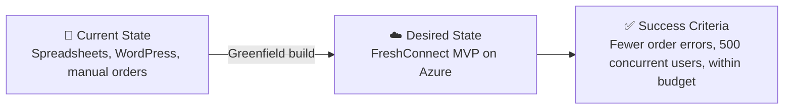

# 📋 Step 1: Requirements - nordic-foods

<strong>📑 Requirements Overview</strong>

- [🎯 Project Overview](#-project-overview)
- [🚀 Functional Requirements](#-functional-requirements)
- [⚡ Non-Functional Requirements (NFRs)](#-non-functional-requirements-nfrs)
- [🔒 Compliance & Security Requirements](#-compliance--security-requirements)
- [💰 Budget](#-budget)
- [🔧 Operational Requirements](#-operational-requirements)
- [🌍 Regional Preferences](#-regional-preferences)
- [📊 Complexity Classification](#-complexity-classification)
- [📋 Summary for Architecture Assessment](#-summary-for-architecture-assessment)
- [References](#references)

> Generated by 02-Requirements agent | 2026-10-14

| ⬅️ Previous | 📑 Index            | Next ➡️                                                           |
| ----------- | ------------------- | ----------------------------------------------------------------- |
| —           | [README](README.md) | [02-architecture-assessment.md](02-architecture-assessment.md)    |

## 🎯 Project Overview

| Field                   | Value                                                                                  |
| ----------------------- | -------------------------------------------------------------------------------------- |
| **Project Name**        | nordic-foods                                                                           |
| **Project Type**        | Full-Stack (web portal + REST API + relational DB)                                     |
| **Timeline**            | 2026-10-14 → MVP in 3 months, ahead of peak season                                     |
| **Primary Stakeholder** | CTO (sponsor: CEO; cost owner: CFO)                                                    |
| **Business Context**    | FreshConnect MVP infrastructure for Nordic Fresh Foods, a Stockholm farm-to-table delivery company |

### Business Context

Source: Nordic Fresh Foods workshop scenario brief (workshop-prep page, treated as data).

| Field               | Value                                                                                                                  |
| ------------------- | ---------------------------------------------------------------------------------------------------------------------- |
| Industry / Vertical | Food & beverage / retail (farm-to-table delivery)                                                                      |
| Company Size        | Mid-Market (500+ partner restaurants, 10,000 active consumers, EUR 2M Series A)                                        |
| Current State       | Greenfield                                                                                                             |
| Migration Source    | N/A (replaces spreadsheets, WordPress and manual processes; no workload migration in scope)                            |
| Business Drivers    | Eliminate ~8% order loss from manual entry, real-time inventory, delivery visibility, seasonal scaling (3x spikes)     |
| Success Criteria    | MVP live before peak season; orders accepted via web portal; reliable at 500 concurrent users; infra within budget     |

### State Transition

## 🚀 Functional Requirements

### Core Capabilities

| #   | Capability        | Priority | Acceptance Criteria                                                              |
| --- | ----------------- | -------- | -------------------------------------------------------------------------------- |
| 1   | Web portal        | 🔴 Must  | Restaurants and consumers can enter orders; supports 500 concurrent users at peak |
| 2   | API backend       | 🔴 Must  | RESTful APIs consumed by the web portal; private (not internet-exposed)           |
| 3   | Relational database | 🔴 Must | Stores orders, customers, inventory and delivery schedules                       |
| 4   | File storage      | 🔴 Must  | Product images, invoices and delivery receipts stored in Blob storage            |
| 5   | Secrets management | 🔴 Must | API keys, connection strings and certificates held in a central vault            |
| 6   | Monitoring        | 🔴 Must  | Application health, performance metrics and alerts available                      |

Out of scope for MVP: mobile app infrastructure (Phase 2), AI/ML route optimization (Phase 2), real-time IoT from delivery vehicles (Phase 3), multi-region DR (initially; revisited in a later challenge).

### User Types

| User Type            | Description                                  | Est. Count        | Access Level |
| -------------------- | -------------------------------------------- | ----------------- | ------------ |
| Consumers            | Place and track orders (external)            | 10,000 active     | Reader/Contributor (own data) |
| Partner restaurants  | Place and track orders (external)            | 500+              | Reader/Contributor (own data) |
| Internal staff       | Operations, customer support (Entra ID)      | Not specified     | Contributor  |
| Platform team        | 3 developers, 1 DevOps                       | 4                 | Admin        |

### Integrations

| System                    | Direction | Protocol | Auth Method | SLA   |
| ------------------------- | --------- | -------- | ----------- | ----- |
| Web portal → API backend  | Outbound from portal (server-side over VNet) | REST | Managed Identity / Entra | 99.9% |

No external client calls the API in the MVP; partner/farm integrations and the mobile app are deferred.

### Data Types

| Category                         | Sensitivity | Est. Volume   | Retention     | Residency |
| -------------------------------- | ----------- | ------------- | ------------- | --------- |
| Customer PII (GDPR)              | 🔴 High     | Not specified | Until account deletion (erasure within 30 days) | EU only   |
| Orders, pricing, inventory       | 🟡 Medium   | Not specified | Orders 7 years (legal retention) | EU        |
| Product images, invoices, receipts | 🟡 Medium | Not specified | Invoices and receipts 7 years; product images not specified | EU        |

### Architecture Pattern

| Field              | Value                                                                              |
| ------------------ | ---------------------------------------------------------------------------------- |
| Workload Pattern   | N-Tier (web portal + REST API + relational DB)                                     |
| Recommended Option | App Service (containerized) + Azure SQL Database + Blob Storage                    |
| Tier               | Cost-Optimized                                                                     |
| Justification      | Small team (3 devs, 1 DevOps) needs managed services; budget is ~EUR 500/month; user selected these services |

## ⚡ Non-Functional Requirements (NFRs)

| WAF Pillar     | Metric             | Target                                   | Current | Gap |
| -------------- | ------------------ | ---------------------------------------- | ------- | --- |
| 🔄 Reliability | SLA                | 99.9%                                    | N/A     | New platform |
| 🔄 Reliability | RTO                | 4 hours (initially)                      | N/A     | New platform |
| 🔄 Reliability | RPO                | 1 hour (initially)                       | N/A     | New platform |
| ⚡ Performance | Page Load (p95)    | < 2 s                                    | N/A     | New platform |
| ⚡ Performance | API Response (p95) | < 300 ms                                 | N/A     | New platform |
| ⚡ Performance | Order Throughput   | ~50 orders/min baseline, 3x at seasonal peak (~150 orders/min) | N/A | New platform |
| ⚡ Performance | Concurrent Users   | 500 at peak                              | N/A     | New platform |
| 🔒 Security    | Auth Method        | Entra ID (internal) + Entra External ID (customers) | — | — |
| 🔒 Security    | Encryption         | At-rest + in-transit (TLS 1.2 minimum)   | —       | —   |
| 💰 Cost        | Monthly Budget     | ~EUR 500 (rising to EUR 700 later)       | —       | —   |
| 🔧 Operations  | Uptime Monitoring  | Yes                                      | —       | —   |

### Scalability

| Dimension        | Current                | 6-Month Projection | 12-Month Projection |
| ---------------- | ---------------------- | ------------------ | ------------------- |
| Users            | 10,000 consumers + 500+ restaurants | Not specified | Not specified |
| Data Volume      | Not specified          | Not specified      | Not specified       |
| Order throughput (orders/min) | ~50 baseline | ~150 at seasonal peak (3x, summer and December) | Not specified |

Peak duration and data-volume growth were not supplied; Step 2 and the load-test plan confirm them. The p95 and throughput targets above are the load-test acceptance criteria.

## 🔒 Compliance & Security Requirements

### Regulatory Frameworks

<strong>PCI-DSS</strong> — Not Applicable

| Requirement             | Applicability | Notes                                     |
| ----------------------- | ------------- | ----------------------------------------- |
| Cardholder data storage | No            | No payment card data stated in scope      |
| Network segmentation    | No            | Covered by the general security baseline  |
| Encryption requirements | No            | Covered by the general security baseline  |

<strong>SOC 2</strong> — Not Applicable

| Trust Principle | Applicability | Notes                |
| --------------- | ------------- | -------------------- |
| Security        | No            | Not requested        |
| Availability    | No            | Not requested        |
| Confidentiality | No            | Not requested        |

<strong>HIPAA</strong> — Not Applicable

| Requirement   | Applicability | Notes             |
| ------------- | ------------- | ----------------- |
| PHI handling  | No            | No health data    |
| BAA required  | No            | Not applicable    |
| Audit logging | No            | Not applicable    |

<strong>GDPR</strong> — Applicable

| Requirement      | Applicability | Notes                                                       |
| ---------------- | ------------- | ----------------------------------------------------------- |
| EU data subjects | Yes           | Customers and restaurants across Scandinavia                |
| Data residency   | Yes           | Customer PII must stay in the EU                            |
| Right to erasure | Yes           | Verified erasure requests completed within 30 days; PII deleted or pseudonymized in live data, and in backups, audit logs and derived copies deleted or made irretrievable within the same 30-day window (their retention is therefore at most 30 days). Orders, invoices and delivery receipts kept 7 years for legal retention are a separate exception: only legally required data is retained, and all other PII in them is erased within the 30-day window |

<strong>ISO 27001</strong> — Not Applicable

| Control Area        | Applicability | Notes         |
| ------------------- | ------------- | ------------- |
| Access control      | No            | Not requested |
| Asset management    | No            | Not requested |
| Incident management | No            | Not requested |

### Data Residency

| Requirement              | Value                                                  |
| ------------------------ | ------------------------------------------------------ |
| Primary Region           | swedencentral                                          |
| Data Sovereignty         | EU-only (customer PII)                                 |
| Cross-region Replication | Not required (multi-region DR out of MVP scope)       |

### Authentication & Authorization

| Requirement       | Value                                                                                      |
| ----------------- | ------------------------------------------------------------------------------------------ |
| Identity Provider | Entra ID (internal users) + Entra External ID (customers). The brief names Azure AD B2C; the user chose Entra External ID as the greenfield replacement |
| MFA Requirement   | Not specified; Architect to propose for internal users                                     |
| RBAC Model        | Azure RBAC for platform; application-level roles for portal users                          |

### Network Security

The brief states public endpoints are acceptable for the MVP. The user resolved this conflict by applying the security baseline.

| Control                     | Required | Notes                                                                                   |
| --------------------------- | -------- | --------------------------------------------------------------------------------------- |
| Private endpoints           | ✅       | App Service-hosted API (inbound), SQL Database, Storage, Key Vault and Container Registry; public network access disabled on each |
| VNet integration            | ✅       | Outbound only: the web portal reaches the private API and data services over the VNet. It does not replace the API's inbound private endpoint |
| Public endpoints acceptable | ✅       | Public HTTPS ingress for the web portal only; the API is private                       |
| WAF required                | ❌       | No additional measures beyond the baseline (budget-constrained)                         |

Application boundary: public-facing web portal; private REST API called only by the portal (server-side). Private DNS resolution is mandatory for every required private endpoint and its consuming VNet in each environment; the Architect and Plan map zones and VNet links, and governance verifies ownership or remediation responsibility.

CI/CD and private operations access: a GitHub-hosted runner with Azure VNet integration (private networking) reaches private endpoints, using OIDC federated workload identity and a least-privilege deployment role. No jump host or Bastion. The runner's networking cost is included in the budget scope; private DNS and connectivity for the runner are an Architect and Plan deliverable.

### Recommended Security Controls

| Control               | Recommended | User Confirmed | Notes                                             |
| --------------------- | ----------- | -------------- | ------------------------------------------------- |
| Managed Identity      | yes         | yes            | Prefer over keys and connection strings           |
| Private Endpoints     | yes         | yes            | API (inbound), SQL, Storage, Key Vault, Container Registry |
| WAF                   | no          | no             | User declined extra measures; public web only     |
| Key Vault for Secrets | yes         | yes            | Brief requires secrets/certificates management    |
| Diagnostic Settings   | yes         | yes            | Audit logging to Log Analytics                    |
| TLS 1.2 Minimum       | yes         | yes            | Baseline                                          |
| Encryption at Rest    | yes         | yes            | Platform default                                  |
| Network Isolation     | yes         | yes            | VNet, NSG and Private Link per baseline           |

## 💰 Budget

> [!NOTE]
> Azure Resource Manager MCP provides retail pricing for detailed estimates during
> architecture assessment (Step 2). Provide an approximate budget here.

| Field              | Value                                                              |
| ------------------ | ------------------------------------------------------------------ |
| 💰 Monthly Budget  | ~EUR 500 total across Dev + Production (rises to EUR 700 after a later DR change) |
| 📅 Annual Budget   | ~EUR 6,000 at the initial budget (monthly × 12)                    |
| 🚦 Limit Type      | 🟡 Soft = infrastructure-only target stated as approximate         |
| 📊 Cost Model Pref | Hybrid (user wants a 1-year reservation; otherwise on-demand)      |

### Budget Decision Rule

- Private networking and the security baseline are non-negotiable and are not traded away for cost.
- If the priced Dev + Production design exceeds EUR 500/month, escalate to the CTO and CFO before proceeding.
- Step 2 compares pay-as-you-go with a 1-year commitment only for steady-state compute and SQL, with break-even and utilization assumptions.

### Cost Optimization Priorities

| Priority                         | Selected | Impact |
| -------------------------------- | -------- | ------ |
| Minimize compute costs           | ✅       | High   |
| Prefer consumption-based pricing | ☐        | Medium |
| Reserved instances acceptable    | ✅       | High   |
| Spot instances for non-critical  | ☐        | Low    |

Cost alert recipient: michal.sakac@atoscz.net. Cost monitoring is enforced because Production is in scope.

## 🔧 Operational Requirements

### Monitoring & Alerting

| Capability             | Required | Tool / Service       | Notes                                           |
| ---------------------- | -------- | -------------------- | ----------------------------------------------- |
| Application monitoring | ✅       | Application Insights | Application health and performance metrics      |
| Log aggregation        | ✅       | Log Analytics        | Workspace-based Application Insights; PII-bearing log and audit-log retention at most 30 days (erasure window) |
| Alert notifications    | ✅       | Email                | michal.sakac@atoscz.net                         |
| Custom dashboards      | ❌       | Azure Monitor        | Not requested                                   |

### Support & Maintenance

| Requirement         | Value                                         |
| ------------------- | --------------------------------------------- |
| Support Hours       | Not specified (Operations stakeholder wants reliability and easy maintenance) |
| On-call Requirement | Not specified                                 |
| Maintenance Windows | Not specified                                 |
| Change Management   | Team approval (small team of 3 devs, 1 DevOps) |

### Backup & Disaster Recovery

| Component              | Backup Frequency               | Retention     | Recovery Method                 |
| ---------------------- | ------------------------------ | ------------- | ------------------------------- |
| Azure SQL Database     | Platform default, meeting RPO 1h | At most 30 days for any PII-bearing copy | Automated point-in-time restore; deletion records reapplied before any restore |
| Blob storage (LRS)     | Not specified                  | At most 30 days for any PII-bearing copy; copies kept longer for the legal exception must have PII deleted or irretrievable within 30 days | Blob content is non-critical: RTO 24h / RPO 12h; the LRS zone-failure risk is accepted by the user |

## 🌍 Regional Preferences

| Preference         | Value         | Justification                                      |
| ------------------ | ------------- | -------------------------------------------------- |
| Primary Region     | swedencentral | Brief mandates it; Stockholm proximity; EU residency |
| Failover Region    | N/A           | Multi-region DR is out of MVP scope                |
| Availability Zones | Single zone accepted | User confirmed zone redundancy is not required for Prod; the Architect reports whether the 99.9% SLA is still achievable |

The single-zone preference does not waive the 99.9% target. If the Architect cannot meet it without zone redundancy, it presents the quantified availability and cost trade-off for explicit sponsor approval of either added redundancy or a revised target.

---

## 📊 Complexity Classification

| Field      | Value                                                                       |
| ---------- | --------------------------------------------------------------------------- |
| Complexity | `standard`                                                                  |
| Criteria   | simple: ≤3 resource types, single region, no custom policies, single env    |
|            | standard: 4–8 resource types, multi-region OR multi-env, ≤3 custom policies |
|            | complex: >8 resource types, multi-region + multi-env, >3 custom policies    |
| Rationale  | Single region with two environments (Dev, Production); about 8 resource types (App Service, SQL, Storage, Key Vault, Container Registry, Application Insights, Log Analytics, networking) |

---

## 📋 Summary for Architecture Assessment

### Handoff Summary

| Aspect               | Key Points                                                                                                  |
| -------------------- | ----------------------------------------------------------------------------------------------------------- |
| Critical Constraints | ~EUR 500/month across Dev + Prod; GDPR EU-only PII in swedencentral; private endpoints (including the API's inbound endpoint, public access disabled) and private API per baseline; public HTTPS ingress for the web portal only |
| Key Decisions        | Terraform; containerized App Service; Azure SQL Database; Blob Storage (LRS pinned); Entra External ID; Key Vault; Container Registry; no messaging, cache or WAF |
| Open Risks           | Private endpoints (API, SQL, Storage, Key Vault, Container Registry), Registry SKU and runner networking may strain the budget (escalate per the Budget Decision Rule); Blob backup/versioning retention not specified; peak duration, data growth and storage/log volumes not supplied (confirmed unknown); single-zone Prod may not meet the 99.9% SLA target; EUR/USD planning rate not supplied (Architect proposes one) |
| Recommended Pattern  | N-Tier (public web portal, private API, private data services)                                              |
| Budget Envelope      | ~EUR 500/month total (EUR 700 later)                                                                        |

### Requirements Completeness

| Section                  | Status | Notes                                                                 |
| ------------------------ | ------ | --------------------------------------------------------------------- |
| Project Overview         | ✅     | Sourced from the workshop brief                                       |
| Functional Requirements  | ✅     | Volumes and retention not specified                                   |
| NFRs                     | ✅     | p95 and throughput targets set; peak duration and growth not supplied |
| Compliance & Security    | ✅     | GDPR only; network posture resolved with user                         |
| Budget                   | ✅     | Soft approximate limit                                                |
| Operational Requirements | ⚠️     | Support hours, on-call and maintenance windows not specified          |

---

## References

> [!NOTE]
> 📚 The following Microsoft Learn resources provide additional guidance.

| Topic                      | Link                                                                                                |
| -------------------------- | --------------------------------------------------------------------------------------------------- |
| Well-Architected Framework | [Overview](https://learn.microsoft.com/azure/well-architected/)                                     |
| Azure Regions              | [Products by Region](https://azure.microsoft.com/explore/global-infrastructure/products-by-region/) |
| Compliance Offerings       | [Azure Compliance](https://learn.microsoft.com/azure/compliance/)                                   |

---

_Requirements captured using [plan-requirements.prompt.md](../../.github/prompts/plan-requirements.prompt.md) template_

---

| ⬅️ — | 🏠 [Project Index](README.md) | ➡️ [02-architecture-assessment.md](02-architecture-assessment.md) |
| ---- | ----------------------------- | ----------------------------------------------------------------- |

