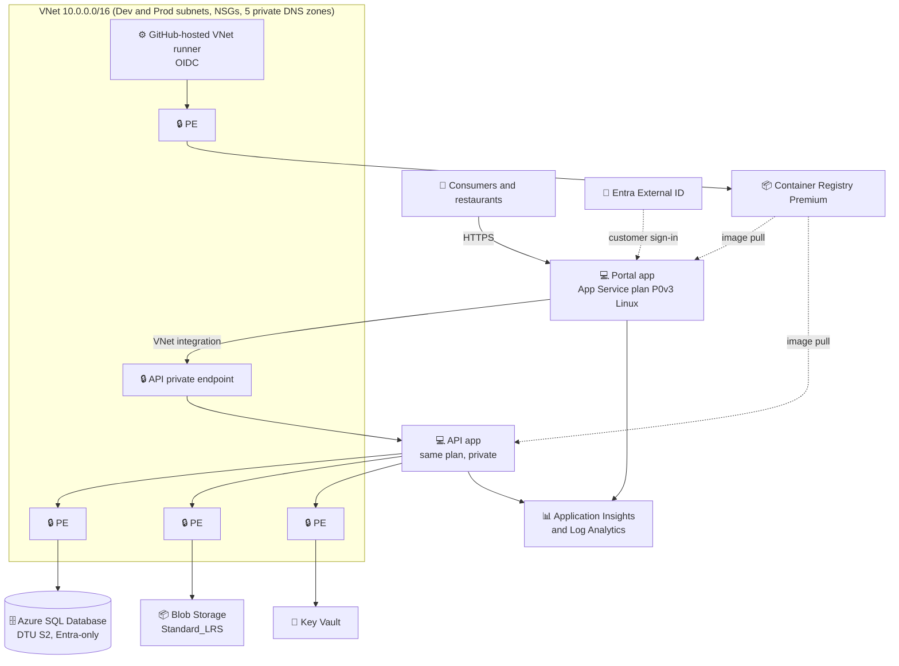
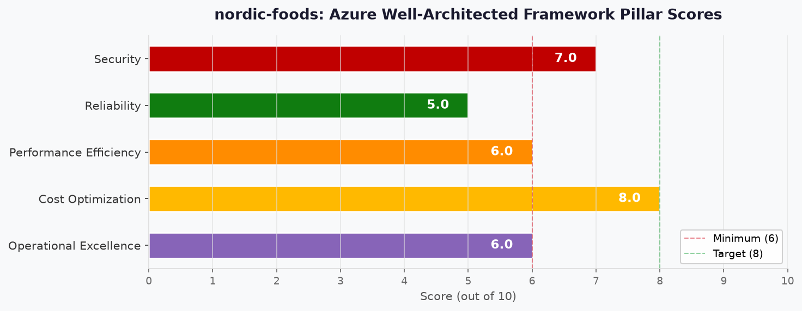

# 🏛️ Step 2: Architecture Assessment - nordic-foods

[Review and approval status](README.md#-workflow-progress)

<strong>📑 Assessment Contents</strong>

- [✅ Requirements Validation](#-requirements-validation)
- [💎 Executive Summary](#-executive-summary)
- [🏛️ WAF Pillar Assessment](#️-waf-pillar-assessment)
- [📦 Resource SKU Recommendations](#-resource-sku-recommendations)
- [🎯 Architecture Decision Summary](#-architecture-decision-summary)
- [🚀 Implementation Handoff](#-implementation-handoff)
- [🔒 Approval Gate](#-approval-gate)
- [References](#references)

> Generated by 03-Architect agent | 2026-10-14

| ⬅️ Previous                              | 📑 Index            | Next ➡️                                            |
| ---------------------------------------- | ------------------- | -------------------------------------------------- |
| [01-requirements.md](01-requirements.md) | [README](README.md) | [03-des-cost-estimate.md](03-des-cost-estimate.md) |

## ✅ Requirements Validation

| Requirement Area        | Status     | Validation Notes                                                                                                                                                        |
| ----------------------- | ---------- | ----------------------------------------------------------------------------------------------------------------------------------------------------------------------- |
| NFRs (SLA, RTO, RPO)    | ⚠️ Partial | SLA 99.9%, RTO 4 h, RPO 1 h are defined. Whether single-zone Prod can meet 99.9% is unverified: numeric SLA percentages are not retrievable (SLA pages redirect to the licensing index). Learn confirms zone redundancy raises the App Service SLA and that Standard DTU SQL has no zone redundancy.         |
| Compliance requirements | ✅ Defined | GDPR only: EU residency, erasure within 30 days, 30-day cap on backup and log copies, 7-year order/invoice/receipt exception.                                           |
| Budget (approximate)    | ✅ Defined | Soft target EUR 500/month across Dev + Prod (EUR 700 later). Planning rate of 1.10 USD per EUR approved at the Step 2 gate, so EUR 500 is about $550/month.             |
| Scale requirements      | ⚠️ Partial | 500 concurrent users, 50 orders/min baseline and 3x peak are defined. Peak duration, data growth and storage/log volumes were not supplied; approved assumptions used.  |
| Security controls       | ✅ Defined | Private endpoints with public access disabled for the API (inbound), SQL, Storage, Key Vault and Container Registry; public HTTPS ingress for the web portal only.      |
| Data residency          | ✅ Defined | `swedencentral` for all regional resources. Entra External ID tenant geography is not verified and needs confirmation (see Security gaps).                              |

> [!WARNING]
> The 99.9% availability target is not waived by the single-zone preference. Achievability is unverified, so a sponsor decision is open (see Reliability).

### Required Capability Dependencies

| Required capability                          | Consumer/producer                         | Dependency and owner                                                                                                                         | Evidence scope/date                                                                  | Design status                           | Runtime status |
| -------------------------------------------- | ----------------------------------------- | -------------------------------------------------------------------------------------------------------------------------------------------- | ------------------------------------------------------------------------------------ | --------------------------------------- | -------------- |
| Portal calls the private API                 | Portal app (server-side) to API app       | VNet integration for portal egress, API inbound private endpoint, `privatelink.azurewebsites.net` zone linked to the VNet; Planner/CodeGen   | Learn App Service networking, 2026-10-14; portal must proxy, the browser cannot reach the API | Designed                                | Unverified     |
| Private CI/CD to private endpoints           | GitHub-hosted runner to Azure resources   | Runner subnet delegated to `GitHub.Network/networkSettings` in the same subscription and region, OIDC identity, DNS and domain-based egress control; Platform team and Planner | GitHub Docs private networking, 2026-10-14; runner subnet 10.0.0.192/27 confirmed at the VNet gate             | Designed                                | Unverified     |
| Private access to SQL, Blob, Key Vault, ACR  | App apps and runner to data services      | 10 private endpoints and 5 private DNS zones linked to the VNet; Planner                                                                      | Subnet plan confirmed at the VNet gate 2026-10-14                                    | Designed                                | Unverified     |
| Private DNS zone ownership                   | Policy-driven DNS vs project-owned zones  | Whether Azure Policy (DINE) already owns the zones or the project deploys them; Governance Discovery (Step 3.5)                              | Pricing assumes 5 project zones in the first tier; not yet checked against policy    | Unresolved                              | Unverified     |
| Monitoring and alerting                      | Apps to Log Analytics and Application Insights | Workspace-based Application Insights, authenticated public ingestion allowed by the baseline, 30-day retention; Planner                  | Requirements 2026-10-14; AMPLS not required by default                              | Designed                                | Unverified     |
| Customer sign-in                             | Consumers and restaurants                 | Entra External ID tenant, free for the first 50,000 MAU per Learn; tenant data location to confirm; Platform team                           | Learn External ID FAQ, 2026-10-14                                                    | Designed                                | Unverified     |
| GDPR erasure and 7-year retention            | Privacy owner, SQL, Blob, backups, logs   | Field-level retention map, erasure runbook, deletion ledger re-applied after restore (see the control below); accountable owner Michal Sakac, field mapping not yet accepted | Requirements 2026-10-14; Learn automated backups 2026-10-14 | Unresolved                              | Unverified     |
| Cost alert delivery                          | Cost budget to Owner role and Action Group | Budget scope and Action Group resolved by the Planner (see Cost Assessment)                                                                  | Workflow gate contract                                                               | Designed                                | Not applicable |

### GDPR Erasure and Retention Control

Approved requirements: verified erasure requests are completed within 30 days across live data, backups, logs and derived copies; only legally required fields in orders, invoices and receipts are kept for 7 years. The design control below makes that implementable.

| Step | Control                                                                                                                                  | Where it runs                       |
| ---- | ---------------------------------------------------------------------------------------------------------------------------------------- | ----------------------------------- |
| 1    | Define the legally required field list for orders, invoices and receipts; every other personal field is outside the 7-year exception.   | Privacy and finance owner, before Step 4 |
| 2    | On a verified request, delete or pseudonymize personal fields in live SQL rows; keep only the required fields in orders, invoices and receipts. | SQL Database, erasure runbook       |
| 3    | Redact or regenerate invoice and receipt documents in Blob so non-required personal data is not retained; copies not needed are deleted. | Blob Storage, erasure runbook       |
| 4    | Backups and logs age out within 30 days: set SQL PITR retention to 30 days or less (Learn: 1 to 35 days, Basic 1 to 7) and keep workspace retention at 30 days; automatic backups cannot be exported or edited, so expiry is the deletion mechanism. | SQL Database, Log Analytics         |
| 5    | Record each erasure in a minimal deletion ledger and re-apply it after any restore before traffic resumes; verify with a replay check.   | SQL Database, restore runbook       |
| 6    | Inventory derived copies (exports, caches, analytics, telemetry); none are planned, and telemetry must not carry personal data or must stay within 30 days. | Application Insights, Log Analytics |

Accountable owner: Michal Sakac (named by the user, 2026-10-14). Their acceptance of the retention field mapping is a prerequisite for Step 4 and is carried as an open approval item. Verification: an erasure test and a timed restore-and-replay test in Dev before go-live.

---

## 💎 Executive Summary

FreshConnect is an N-Tier greenfield MVP for Nordic Fresh Foods: a public web portal, a private REST API, a relational database and Blob storage in `swedencentral`, for two environments (Dev and Prod) built with Terraform. The recommended design uses containerized App Service plans, Azure SQL Database (Entra-only), a user-pinned LRS Blob account, Key Vault, a shared Container Registry Premium, workspace-based Application Insights, and ten private endpoints with five private DNS zones. It optimizes **Cost** while treating the security baseline as non-negotiable.

The worker-verified estimate is **$348.77/month** for Dev, Prod and shared resources, about EUR 317 at the approved 1.10 USD per EUR planning rate, which is 63% of the EUR 500 budget. The main residual risks are unverified availability (single-zone, single-instance Prod against a 99.9% target) and unverified sizing for 500 concurrent users.

### Recommended Architecture

---

## 🏛️ WAF Pillar Assessment

### Overall Scores

| Pillar                    | Score | Confidence | Summary                                                                                                  |
| ------------------------- | ----- | ---------- | -------------------------------------------------------------------------------------------------------- |
| 🔒 Security               | 7/10  | Medium     | Strong private-network baseline; no WAF on the public portal and open identity/egress items.             |
| 🔄 Reliability            | 5/10  | Low        | Single zone, single instance and LRS; 99.9% target unverified; no DR by scope.                           |
| ⚡ Performance            | 6/10  | Low        | Sizing is a price-proxy guess for 500 users; one shared 1 vCPU instance has no load evidence.            |
| 💰 Cost Optimization      | 8/10  | Medium     | 63% of budget; Dev costs as much as Prod because of repo feature floors; usage assumptions unvalidated.  |
| 🔧 Operational Excellence | 6/10  | Medium     | Terraform, OIDC and monitoring are planned; support model, dashboards and runner egress are open.        |

**Composite average**: 6.4/10 (7 + 5 + 6 + 8 + 6, divided by 5).
**Confidence rule**: High means every material fact is verified from an official source and no validation or sponsor decision is open; Medium means the main facts are verified and the rest are approved assumptions; Low means a key dependency is unverified or unmeasured (numeric SLAs, load test).
**Primary Pillar Optimized**: Cost Optimization, within the non-negotiable security baseline.
**Trade-offs Accepted**: single-zone, single-instance Prod; LRS Blob (user pin); no WAF; no DR; one VNet shared by Dev and Prod through subnets; one shared Container Registry.

---

### 🔒 Security Assessment (7/10)

**Score basis (Medium confidence):** private endpoints, Entra-only SQL, Managed Identity, Key Vault and Premium Container Registry were verified from Learn and the repo baseline, which supports a high base score; two points are withheld for the declined WAF, unverified MFA and tenant geography, and open runner egress control.

**Strengths:**

- Private endpoints with public access disabled for the API, SQL, Storage, Key Vault and Container Registry; Container Registry private endpoints require the Premium tier (Learn).
- Managed Identity over keys, Entra-only SQL authentication, Key Vault for secrets, TLS 1.2 minimum, OIDC federated identity for deployments.
- Private DNS is planned for every private endpoint; no jump host or Bastion is needed.

**Gaps:**

- No WAF or DDoS layer in front of the public portal (user declined); protection rests on baseline controls.
- MFA for internal users and Conditional Access licensing are not specified or verified.
- Entra External ID tenant data location is not verified against the EU residency requirement.
- GitHub-hosted runner egress control is needed (DNS or domain-based, no TLS interception allowed by the feature).

**Recommendations:**

1. Confirm the Entra External ID tenant geography before Step 4; treat it as an EU Data Boundary check.
2. Enforce MFA for internal users with security defaults or Conditional Access once licensing is confirmed.
3. Keep Container Registry admin disabled and use Managed Identity for image pull.
4. Restrict the runner's egress by domain and record the allow-list in the plan.

### 🔄 Reliability Assessment (5/10)

**Score basis (Low confidence):** a single zone and a single Prod instance, LRS-only Blob, no DR and an uncomputable composite SLA give a mid score at best; Learn evidence confirms what zone redundancy would and would not cover, but numeric SLAs and a timed restore are still missing.

**Strengths:**

- Backups stay in-region by choosing Local or Zone backup redundancy for SQL; the default is geo-redundant to the paired region (Learn).
- SQL local redundancy keeps committed data through local failures (Learn: RPO zero for failover), and transaction log backups run about every 10 minutes (Learn), which supports the 1-hour RPO for point-in-time restore.
- Dev and Prod use separate plans, so Dev load cannot affect Prod.
- RTO and RPO for Blob (24 h / 12 h) were agreed with the user.

**Gaps:**

- Composite SLA cannot be quoted: numeric SLA percentages for App Service, SQL Database and Blob are not retrievable (the SLA pages redirect to the licensing index; Learn states only that a zone-redundant App Service plan raises its SLA). The serial-path rule still applies: a composite meets 99.9% only if every serial component is individually above 99.9%.
- Prod runs one P0v3 instance in one zone; a restart, platform update or zone event interrupts both apps.
- Zone redundancy on App Service needs a Premium v2 to v4 plan, at least 2 instances and a scale unit that supports it, adds no separate charge and makes the whole plan zone redundant (Learn). It would not cover SQL (Basic and Standard DTU have no zone redundancy; Premium DTU or vCore would be needed) or the LRS Blob pin.
- No multi-region DR (out of MVP scope); Sweden South is a restricted-access region, so in-EU geo-replication is not freely available (Learn).
- Seven-year invoices and receipts sit on LRS-only Blob, a durability risk for legally retained data.
- Restore time depends on database size, so the 4-hour RTO needs a timed restore test; the 1-hour RPO for point-in-time restore is supported by 10-minute log backups.

**Recommendations:**

1. Sponsor decision (open): the 99.9% target is retained, and the current design is not shown to meet it. Changes needed to demonstrate it: (a) a zone-redundant App Service plan on a SKU the repo zone-redundancy matrix lists (P1v3/P2v3 or P1v4/P2v4, two instances; not priced, because P1v3 returned no on-demand meter in `swedencentral` and P1v4 was not priced); (b) SQL on a tier with zone redundancy (Premium DTU or vCore; not priced); (c) Blob redundancy above the user-pinned LRS (a pin change, not made here); (d) the numeric published SLAs for every serial component and the computed composite; (e) a timed SQL restore against the 4-hour RTO and 1-hour RPO. Until the sponsor chooses between adding these, keeping the topology with quantified residual risk, or revising the target, availability stays a documented gap. Approving this assessment does not close the requirement; the sponsor's recorded choice is an open gate item carried to Step 3.5 and Step 4. Two P0v3 instances ($129.94/month versus $64.97/month, +$64.97/month, about $413.74/month in total) add capacity and instance redundancy only; P0v3 is not in the repo matrix, so zone placement is not established and this option is not a reliability mitigation.
2. Obtain the numeric published SLAs (not retrievable this session) at Step 3.5 or 4, compute the composite then, and run a timed Dev restore at expected data size to check the 4-hour RTO.
3. Define a copy or regeneration path for 7-year invoices and receipts so LRS loss is recoverable.

### ⚡ Performance Assessment (6/10)

**Score basis (Low confidence):** co-located tiers and a defined load-test target help, but one shared 1 vCPU instance and an unmeasured DTU S2 database have no load evidence, so the score is an estimate until the 500-user test.

**Strengths:**

- All tiers are co-located in one region (`swedencentral`), and the web, API and data services are separated by environment-specific plans and subnets.
- Dev is sized separately from Prod, and the 3x seasonal peak is a defined acceptance test.

**Gaps:**

- P0v3 is 1 vCPU and 4 GB (official pricing page) and carries both the portal and the API for 500 concurrent users; capacity is fixed at one instance.
- DTU capacity for S2 was not verified; sizing has no load evidence.
- The browser cannot call a private API, so the portal must proxy server-side, adding one hop to the p95 budget (2 s page, 300 ms API).

**Recommendations:**

1. Load-test Prod at 500 concurrent users and 150 orders/min before buying any reservation.
2. Plan autoscale for the seasonal peak; each extra P0v3 instance costs the same as the first at pay-as-you-go.
3. Keep S1 ($29.43/month, comparison only) as the downsize candidate and the next DTU tier as the upsize path.

### 💰 Cost Assessment (8/10)

**Score basis (Medium confidence):** every dollar figure is worker-verified and the total is 63% of budget, but the usage assumptions are unvalidated and Dev costs as much as Prod ($64.97 plan each) only because of repo feature floors, so one point is withheld from the 9 the raw utilization would suggest.

| Metric           | Value                                                                             |
| ---------------- | --------------------------------------------------------------------------------- |
| Monthly Estimate | ~$348.77/month (about EUR 317 at 1.10 USD per EUR)                                |
| Annual Estimate  | ~$4,185.28/year                                                                   |
| Budget Status    | ✅ Within budget: 63% of EUR 500 (about $550); 45% of the later EUR 700            |
| Confidence       | Medium                                                                            |

> 📎 Full cost breakdown: [03-des-cost-estimate.md](03-des-cost-estimate.md)

**Cost Optimization Applied:**

- Dev uses the cheapest tiers that satisfy the repo feature floors (P0v3 and DTU S0); B1 and DTU Basic would save $61.65/month if the maintainers reconcile the floors with Learn.
- One shared Container Registry Premium, which is the only tier that supports private endpoints.
- 1-year reservation on the Prod P0v3 plan saves $22.64/month ($271.64/year, 34.84%) per the worker; buy only after load testing. DTU SQL databases cannot be reserved (Learn), so no SQL commitment scenario is priced.
- Serverless SQL was rejected for Prod: auto-pause is General Purpose only and not useful for an always-on Prod.

**Cost monitoring routing:** budget at the scope the Planner derives (scope not yet set; decided at Step 4). Notifications carry `contactRoles: ["Owner"]` plus the project Action Group (`ag-cost-nordic-foods`), created with the alert recipient recorded at Step 1 or reused if one is found at Planner preflight. The anomaly alert is subscription-scoped and daily. Non-production may opt down through `cost_monitoring_mode` set to `minimal` or `deferred`.

### 🔧 Operational Excellence Assessment (6/10)

**Score basis (Medium confidence):** Terraform, OIDC, monitoring and cost alerts are planned and verified, but support model, dashboards, runbooks, AVM-TF availability and runner egress are open.

**Strengths:**

- Terraform with remote state (a shared Blob state account is a prerequisite), OIDC deployments and a team approval model suited to 3 developers and 1 DevOps engineer.
- Application Insights and Log Analytics with email alerts; 30-day log retention aligned to the GDPR window.

**Gaps:**

- Support hours, on-call and maintenance windows are not specified.
- No dashboards were requested; no runbook for erasure requests, restores or private-endpoint DNS failures.
- AVM-TF module availability for the recommended services was not verified; some resources may need raw `azurerm` code.

**Recommendations:**

1. Terraform notes for Step 4: pin the `azurerm` provider, lock state in the Blob backend, use `random_suffix` for globally unique names, and confirm AVM-TF modules per service.
2. Add a deletion-record re-apply procedure after any SQL restore (GDPR erasure).
3. The runner subnet 10.0.0.192/27 with `GitHub.Network/networkSettings` delegation is confirmed (27 usable addresses after Azure's 5 reserved); record the maximum concurrent runners in the plan and reopen the size only if demand exceeds it.

### Service Maturity Assessment

| Service                          | Status     | Evidence and notes                                                                                                        |
| -------------------------------- | ---------- | ------------------------------------------------------------------------------------------------------------------------- |
| App Service (Linux, Premium v3)  | ✅ Offered | Priced in `swedencentral`; the official pricing page also lists Premium v4, whose regional availability and price were not checked. |
| App Service Basic (not selected) | ⚠️ Caution | Learn says VNet integration and private endpoints are supported from Basic; the repo rule says "not on Basic". The repo rule controls for validation, so Dev uses P0v3; maintainers may reconcile the rule. |
| Azure SQL Database (DTU)         | ⚠️ Caution | S2 and S0 priced; DTU capacity per tier not verified. Learn describes Private Link as a logical-server setting with no tier restriction, while the repo rule says private endpoints need SQL "Standard or higher"; the repo rule controls, so Dev uses S0 (Basic not selected). DTU databases cannot be reserved and Basic/Standard have no zone redundancy (Learn). |
| Blob Storage (Standard LRS)      | ✅ Offered | User-pinned LRS; zone-wide loss is an accepted risk.                                                                       |
| Container Registry Premium       | ✅ Offered | Required for private endpoints and selected-network rules (Learn).                                                         |
| Entra External ID                | ✅ Offered | Replaces Azure AD B2C, which is not available for new tenants (repo deprecation table); free for the first 50,000 MAU.    |
| Key Vault, Log Analytics, App Insights | ✅ Offered | Workspace-based Application Insights; no deprecated or preview service is recommended.                                |
| GitHub-hosted runner with VNet   | ✅ Offered | Requires a delegated subnet in the same subscription and region; runner minutes are billed by GitHub, not Azure.         |

---

## 📦 Resource SKU Recommendations

| Service                         | Recommended SKU                  | Configuration                                      | Monthly Est. | Justification                                                            |
| ------------------------------- | -------------------------------- | -------------------------------------------------- | ------------ | ------------------------------------------------------------------------ |
| App Service plan, Prod          | Linux P0v3                       | 1 instance, single zone, portal + private API      | $64.97       | Lowest Premium tier; supports reservation; not in the repo zone-redundancy matrix. |
| App Service plan, Dev           | Linux P0v3                       | 1 instance                                         | $64.97       | Meets the repo vnet-integration floor (S1 or higher); cheaper than S1.   |
| Azure SQL Database, Prod        | DTU Standard S2                  | Entra-only, Local backup redundancy, PITR <= 30 d  | $73.61       | Mid candidate pending load test.                                         |
| Azure SQL Database, Dev         | DTU Standard S0                  | Entra-only                                         | $14.72       | Meets the repo private-endpoint floor (Standard or higher).              |
| Blob Storage (user pin)         | Standard_LRS Hot                 | Prod 100 GB, Dev 10 GB                             | $2.93        | Pin preserved; $2.70 Prod, $0.23 Dev.                                    |
| Container Registry              | Premium                          | 1 shared registry                                  | $50.69       | Only tier supporting private endpoints.                                  |
| Key Vault                       | Standard                         | 1 per environment, operations only                 | $0.36        | No HSM requirement.                                                      |
| Private endpoints               | Standard                         | 10 endpoints (4 Prod, 4 Dev, 2 shared), 60 GB/mo   | $73.60       | Baseline requirement; $73.00 hours plus $0.60 data processing.           |
| Private DNS                     | Private zones                    | 5 zones, 1M queries/month                          | $2.90        | Mandatory for every private endpoint.                                    |
| Log Analytics + App Insights    | Pay-as-you-go                    | Prod 5 GB, Dev 1 GB per month, 30-day retention    | $0.00        | Rests on the zero-priced first ingestion band; see Cost risks.           |
| Terraform-state storage         | Standard_LRS Hot                 | 1 GB, shared                                       | $0.03        | Remote state backend prerequisite.                                       |
| Entra External ID               | Core offering                    | About 10,500 MAU                                   | No charge within 50,000 MAU (Learn) | Free tier covers the stated user base.                  |
| **Total**                       |                                  |                                                    | **$348.77**  | Dev + Prod + shared, pay-as-you-go.                                      |

<strong>App Service plan</strong> — Pricing Tier Comparison

| Tier                     | vCPU / RAM                | Price/mo            | Fits?                                             |
| ------------------------ | ------------------------- | ------------------- | ------------------------------------------------- |
| Basic B1                 | 1 / 1.75 GB               | $13.14              | ❌ Fails the repo vnet-integration floor        |
| Standard S1              | Not verified              | $69.35              | ❌ Costs more than P0v3, no zone redundancy       |
| Premium v3 P0v3          | 1 / 4 GB                  | $64.97              | ⚠️ Prod pending load test                         |
| Premium v3 P0v3 x2       | 1 / 4 GB per instance     | $129.94             | ⚠️ Extra capacity only, not shown zone redundant  |

**Selected**: P0v3 for Prod and Dev. Dev needs P0v3 only to meet the repo floor; P0v3 is cheaper than S1. P1v3 returned no on-demand meter in `swedencentral`. Zone redundancy needs a Premium v2 to v4 plan and at least two instances (Learn), but the repo zone-redundancy matrix lists P1v3/P2v3 and P1v4/P2v4, not P0v3, so a zone-redundant path needs a listed SKU and a new price at Step 4 or later.

<strong>Azure SQL Database</strong> — Pricing Tier Comparison

| Tier                          | Capacity            | Price/mo           | Fits?                                                 |
| ----------------------------- | ------------------- | ------------------ | ----------------------------------------------------- |
| Basic                         | Not verified        | $4.90              | ❌ Fails the repo private-endpoint floor             |
| Standard S0                   | Not verified        | $14.72             | ✅ Dev                                                |
| Standard S1                   | Not verified        | $29.43             | ⚠️ Downsize candidate if load test allows             |
| Standard S2                   | Not verified        | $73.61             | ⚠️ Prod pending load test                             |
| General Purpose serverless    | Not priced in full  | Compute $122.23 at 1 vCore; storage and backup unresolved | ❌ Auto-pause not useful for always-on Prod |

**Selected**: S2 for Prod, S0 for Dev. DTU databases cannot be reserved and Basic/Standard DTU have no zone redundancy (Learn).

---

## 🎯 Architecture Decision Summary

| Decision                  | Choice                                                         | Rationale                                                                                          |
| ------------------------- | -------------------------------------------------------------- | -------------------------------------------------------------------------------------------------- |
| Architecture pattern      | N-Tier: public portal, private API, private data services      | Small team; managed services; matches the brief.                                                   |
| Compute                   | Containerized App Service, one plan per environment            | Portal and API share a plan to save cost.                                                          |
| Network posture           | One VNet 10.0.0.0/16, per-environment subnets, 10 private endpoints, 5 private DNS zones | Baseline requirement; one VNet keeps cost low. Subnet plan confirmed at the gate.     |
| Database                  | Azure SQL DTU, Entra-only; S2 Prod, S0 Dev                     | Predictable cost; serverless auto-pause is not useful for Prod.                                    |
| Dev tiers                 | P0v3 and DTU S0, not B1 and Basic                              | Repo feature floors control validation; costs +$61.65/month over B1 and Basic.                     |
| Storage redundancy        | Standard_LRS (user pin)                                        | Pin preserved; LRS risk accepted by the user.                                                      |
| Availability              | Single zone, single instance in Prod                           | User accepted; 99.9% achievability open for sponsor decision.                                      |
| Backups and logs          | Local SQL backup redundancy; PITR and logs at most 30 days     | Keeps copies in-region and inside the GDPR erasure window.                                         |
| CI/CD                     | GitHub-hosted VNet runner with OIDC                            | No jump host or Bastion; runner minutes are GitHub billing.                                        |
| Commitment                | On-demand now; 1-year P0v3 reservation after load test         | Prod reservation saves $22.64/month but locks the SKU; DTU SQL cannot be reserved (Learn).                                                  |
| Identity                  | Entra ID (internal), Entra External ID (customers)             | Replaces Azure AD B2C; free within 50,000 MAU.                                                     |

### Top Architecture Risks

| Risk                                                         | WAF Pillar | Likelihood | Impact  | Mitigation                                                                  |
| ------------------------------------------------------------ | ---------- | ---------- | ------- | --------------------------------------------------------------------------- |
| 99.9% target unmet by single-zone, single-instance Prod      | 🔄         | 🔴 High    | 🔴 High | Sponsor decision; a listed zone-redundant SKU (unpriced), SQL and Blob changes; verify SLAs. |
| P0v3 and S2 undersized for 500 concurrent users              | ⚡         | 🟡 Med     | 🔴 High | Load test before go-live and before any reservation.                         |
| LRS-only Blob holds 7-year invoices and receipts             | 🔄         | 🟡 Med     | 🟡 Med  | Copy or regeneration path defined at Step 4.                                 |
| No WAF in front of the public portal                         | 🔒         | 🟡 Med     | 🟡 Med  | Baseline controls, runner egress limits; revisit if exposure grows.          |
| GDPR field-level exception undefined (owner named: Michal Sakac) | 🔒 | 🟡 Med     | 🔴 High | Owner accepts the retention field mapping before Step 4; control defined above. |

---

## 🚀 Implementation Handoff

### Handoff Readiness

Substantive readiness and prerequisites are recorded here. Current architecture and independent cost-feasibility
review evidence and human approval are recorded in recall, decision sidecars and the project index; see the
[workflow progress](README.md#-workflow-progress). An assessment write is not approval. After the approval gate the
next human handoff is Design (Step 3) when it is not skipped, then Governance Discovery (Step 3.5).

| Parameter      | Value                                                           |
| -------------- | --------------------------------------------------------------- |
| Region         | swedencentral                                                   |
| Environment    | Dev and Prod                                                    |
| Budget         | EUR 500/month soft target (about $550); estimated $348.77       |
| Resource Count | 15 line items below (private endpoints and zones counted by row) |

**Open items carried to Step 3.5 and 4**:

- Sponsor decision on the 99.9% availability target versus the single-zone preference.
- Legally required field list for the 7-year exception, accepted by the named owner (Michal Sakac).
- Numeric published SLAs and a timed SQL restore at expected size.
- Private DNS zone ownership against policy (DINE) and the maximum concurrent runner count against the confirmed 10.0.0.192/27 runner subnet.
- Maintainers may reconcile the repo feature floors (B1, Basic) with Learn, which could save $61.65/month.

### Resources to Provision

| #   | Resource                              | SKU                    | Key Config                                                       |
| --- | ------------------------------------- | ---------------------- | ---------------------------------------------------------------- |
| 1   | VNet and NSGs                         | n/a                    | 10.0.0.0/16, 5 subnets, one NSG per subnet                       |
| 2   | App Service plan, Prod                | Linux P0v3 x1          | Portal and private API apps, VNet integration, containers        |
| 3   | App Service plan, Dev                 | Linux P0v3 x1          | Same app layout                                                  |
| 4   | Azure SQL Database, Prod              | DTU S2                 | Entra-only, public access disabled, Local backup redundancy      |
| 5   | Azure SQL Database, Dev               | DTU S0                 | Entra-only, public access disabled                               |
| 6   | Storage accounts (Dev, Prod)          | Standard_LRS           | User pin; no public blob, no shared key                          |
| 7   | Key Vault x2                          | Standard               | Public access disabled, RBAC                                     |
| 8   | Container Registry                    | Premium                | Admin disabled, selected-network and private endpoint            |
| 9   | Log Analytics x2, Application Insights x2 | Pay-as-you-go      | Workspace-based, 30-day retention                                |
| 10  | Private endpoints x10                 | Standard               | API, SQL, Storage, Key Vault per environment; ACR and state shared |
| 11  | Private DNS zones x5 with VNet links  | Private                | azurewebsites, database.windows, blob, vaultcore, azurecr        |
| 12  | Terraform-state storage account       | Standard_LRS           | Remote state, locking, private endpoint; bootstrapped before the main backend (see below) |
| 13  | Entra External ID tenant              | Core                   | Customer sign-in; confirm EU data location                       |
| 14  | GitHub runner network settings        | n/a                    | Delegated subnet `GitHub.Network/networkSettings`                |
| 15  | Cost budgets and Action Group         | n/a                    | Scope and recipients resolved by the Planner                     |

**State backend bootstrap order (Step 4):** the Terraform-state storage account is created by a separate bootstrap phase (or named as a pre-existing platform dependency) before the main configuration initializes its backend. The main backend is initialized only after the account's private endpoint, `privatelink.blob` DNS link, access role and runner connectivity are in place; until then `terraform init` cannot reach the backend.

**Confirmed subnet map (VNet 10.0.0.0/16, carried from the VNet planning gate; all five subnets have an NSG and no route table):**

| Purpose                      | CIDR           | Delegation                         | Private endpoints hosted                          |
| ---------------------------- | -------------- | ---------------------------------- | ------------------------------------------------- |
| App integration, Prod        | 10.0.0.0/26    | `Microsoft.Web/serverFarms`        | None                                              |
| App integration, Dev         | 10.0.0.64/26   | `Microsoft.Web/serverFarms`        | None                                              |
| Private endpoints, Prod and shared | 10.0.0.128/27 | None                         | Prod API, SQL, Storage, Key Vault, plus shared ACR and state |
| Private endpoints, Dev       | 10.0.0.160/27  | None                               | Dev API, SQL, Storage, Key Vault                  |
| GitHub runner                | 10.0.0.192/27  | `GitHub.Network/networkSettings`   | None; maximum concurrent runners confirmed at Step 4 |

### Security Requirements for Implementation

| Requirement                 | Implementation                                                                              |
| --------------------------- | ------------------------------------------------------------------------------------------- |
| HTTPS only, TLS 1.2 minimum | App Service `https_only`, `minimum_tls_version = "1.2"`                                      |
| No public data access       | `public_network_access_enabled = false` on SQL, Storage, Key Vault, Container Registry, API app |
| Managed Identity            | System or user-assigned identities for apps; RBAC role assignments instead of keys           |
| Entra-only SQL              | Entra administrator, SQL authentication disabled                                             |
| Private DNS                 | Zone per service, linked to the VNet, ownership checked against policy                       |
| No shared-key Storage       | `shared_access_key_enabled = false`, `allow_nested_items_to_be_public = false`               |
| Private ACR image pull      | Both apps in Dev and Prod enable App Service VNet image pull (`vnet_image_pull_enabled` or equivalent), `privatelink.azurecr.io` resolves through the integration VNet, and each app identity holds AcrPull on the shared registry before deployment; Step 4 readiness includes a private image-pull connectivity check |

### Monitoring Requirements for Implementation

| Requirement              | Implementation                                                                            |
| ------------------------ | ----------------------------------------------------------------------------------------- |
| Application monitoring   | Workspace-based Application Insights per environment                                      |
| Log retention            | 30 days on workspaces holding PII-bearing logs                                            |
| Diagnostics              | Diagnostic settings to Log Analytics for SQL, Key Vault, Storage, App Service, Container Registry, and the supported networking resources (VNet, NSGs, private endpoints); categories named at Step 4, 30-day retention kept for PII-bearing data |
| Alerts                   | Email alerts and cost budgets via the project Action Group                                |
| Availability alert       | Failed-request and availability alert on the Prod portal and API through Application Insights; threshold and window are Step 4 assumptions until the load test |
| Latency alert            | API p95 against the 300 ms target and page p95 against the 2 s target; thresholds from load-test results |
| Database alert           | Prod SQL DTU consumption and connection-failure signals; thresholds set after sizing     |
| Alert routing            | Prod alerts go by email to the recipient recorded at Step 1 through the project Action Group; Dev routing optional |

---

## 🔒 Approval Gate

> [!IMPORTANT]
> **🏗️ Architecture Assessment: approval tracked separately**
>
> | Pillar      | Score |
> | ----------- | ----- |
> | Security    | 7/10  |
> | Reliability | 5/10  |
> | Performance | 6/10  |
> | Cost        | 8/10  |
> | Operations  | 6/10  |
>
> **Estimated Monthly Cost**: ~$348.77 (within budget: about EUR 317 of EUR 500)
>
> **Confidence Level**: Medium
>
> Current status: [project workflow progress](README.md#-workflow-progress) and recall Step 2 decisions.
> Review evidence: [architecture findings](challenge-findings-architecture.json) and
> [cost-feasibility findings](challenge-findings-cost-estimate.json); use actual pass paths in deep mode.
> Per-finding dispositions: [decision sidecar](challenge-findings-architecture-decisions.json), when findings exist.

## References

| Topic                                  | Link                                                                                                                                                     |
| -------------------------------------- | -------------------------------------------------------------------------------------------------------------------------------------------------------- |
| App Service VNet integration           | [Overview](https://learn.microsoft.com/azure/app-service/overview-vnet-integration)                                                                      |
| App Service zone redundancy            | [Reliability](https://learn.microsoft.com/azure/reliability/reliability-app-service#resilience-to-availability-zone-failures)                            |
| Container Registry network security    | [Secure registry](https://learn.microsoft.com/azure/container-registry/secure-container-registry#network-security)                                       |
| SQL backup storage redundancy          | [Automated backups](https://learn.microsoft.com/azure/azure-sql/database/automated-backups-overview?view=azuresql#backup-storage-redundancy)            |
| Entra External ID pricing              | [FAQ](https://learn.microsoft.com/entra/external-id/customers/faq-customers#external-id-pricing)                                                         |
| GitHub private networking for runners  | [Configuring private networking](https://docs.github.com/en/organizations/managing-organization-settings/configuring-private-networking-for-github-hosted-runners-in-your-organization) |
| Composite SLA formula                  | [Cloud Adoption Framework](https://learn.microsoft.com/azure/cloud-adoption-framework/manage/protect#manage-reliability)                                 |
| SQL Database reserved capacity         | [Reservations](https://learn.microsoft.com/azure/azure-sql/database/reserved-capacity-overview?view=azuresql)                                           |
| SQL Database availability              | [Local and zone redundancy](https://learn.microsoft.com/azure/azure-sql/database/high-availability-sla-local-zone-redundancy?view=azuresql)              |
| SQL automated backups                  | [Backups and retention](https://learn.microsoft.com/azure/azure-sql/database/automated-backups-overview?view=azuresql)                                  |
| Well-Architected Framework             | [Overview](https://learn.microsoft.com/azure/well-architected/)                                                                                          |

---

| ⬅️ [01-requirements.md](01-requirements.md) | 🏠 [Project Index](README.md) | ➡️ [03-des-cost-estimate.md](03-des-cost-estimate.md) |
| ------------------------------------------- | ----------------------------- | ----------------------------------------------------- |

