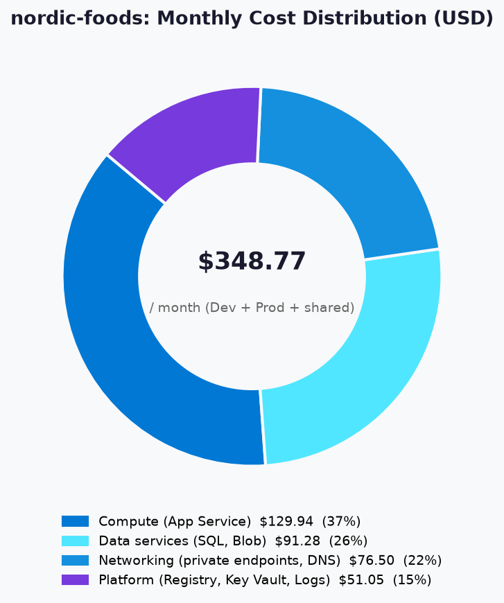
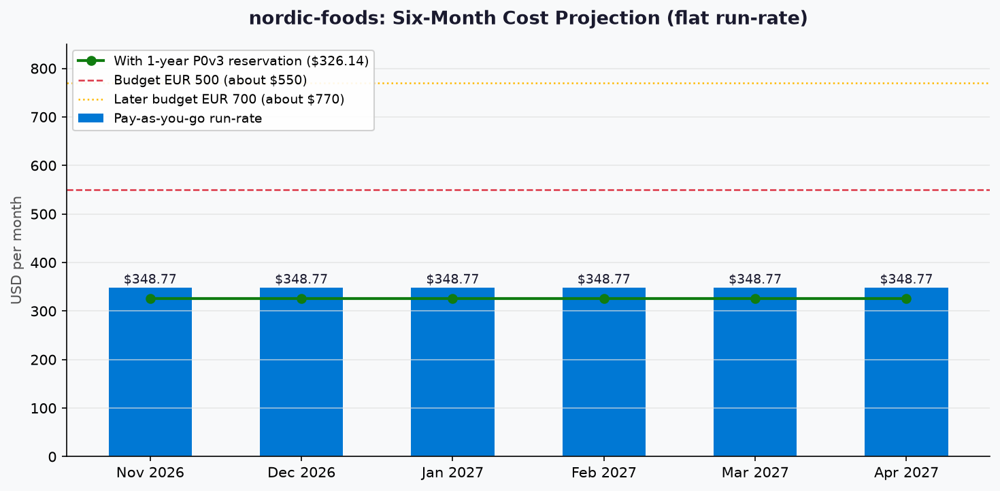

# 💰 Azure Cost Estimate: nordic-foods


[Review and approval status](README.md#-workflow-progress)


<details open>
<summary><strong>📑 Cost Estimate Contents</strong></summary>

- [💵 Cost At-a-Glance](#-cost-at-a-glance)
- [✅ Decision Summary](#-decision-summary)
- [🔁 Requirements → Cost Mapping](#-requirements--cost-mapping)
- [📊 Top 5 Cost Drivers](#-top-5-cost-drivers)
- [🏛️ Architecture Overview](#️-architecture-overview)
- [🧾 What We Are Not Paying For (Yet)](#-what-we-are-not-paying-for-yet)
- [⚠️ Cost Risk Indicators](#️-cost-risk-indicators)
- [🎯 Quick Decision Matrix](#-quick-decision-matrix)
- [💰 Savings Opportunities](#-savings-opportunities)
- [🧾 Detailed Cost Breakdown](#-detailed-cost-breakdown)
- [References](#references)

</details>

> Generated by 03-Architect agent | 2026-10-14

| ⬅️ Previous                                                    | 📑 Index            | Next ➡️                                                      |
| -------------------------------------------------------------- | ------------------- | ------------------------------------------------------------ |
| [02-architecture-assessment.md](02-architecture-assessment.md) | [README](README.md) | [04-governance-constraints.md](04-governance-constraints.md) |

**Generated**: 2026-10-14
**Region**: swedencentral
**Environment**: Development and Production (plus shared project resources)
**MCP Tools Used**: get_retail_prices (Azure Resource Manager MCP); Azure Retail Prices API direct fallback for Azure DNS private zones and queries
**Architecture Reference**: [02-architecture-assessment.md](02-architecture-assessment.md)
**Pricing Evidence**: [02-cost-estimate-v3.json](02-cost-estimate-v3.json) (manifest rev 3 services, private endpoints, private DNS), [02-cost-estimate-ancillary-v2.json](02-cost-estimate-ancillary-v2.json) (Container Registry, Key Vault, Log Analytics, state storage), DNS direct-API evidence in `02-cost-estimate.json.retail-evidence/azure-dns.json`, and the comparison-only [02-sku-candidates.json](02-sku-candidates.json). Earlier FAILED attempts `02-cost-estimate.json` and `02-cost-estimate-ancillary.json` and the superseded rev 2 run `02-cost-estimate-v2.json` are preserved and not used as totals.

Review and human approval are recorded in recall, decision sidecars and the project index.
Finalize this document before review; do not change its status text afterward merely to record approval.

## 💵 Cost At-a-Glance

> **Monthly Total: ~$348.77** | Annual: ~$4,185.28
>
> ```text
> Budget: EUR 500/month (soft, about $550 at 1.10 USD per EUR) | Utilization: 63% ($348.77 of $550)
> ```
>
> | Status            | Indicator                                      |
> | ----------------- | ---------------------------------------------- |
> | Cost Trend        | ➡️ Stable                                      |
> | Savings Available | 💰 $271.64/year with a 1-year P0v3 reservation |
> | Compliance        | ✅ GDPR: EU residency, private networking      |

## ✅ Decision Summary

- ✅ Confirmed inputs: the SKU confirmation gate approved the architect-derived rows (Prod P0v3 and DTU S2, Dev P0v3 and DTU S0 after the accepted Dev SKU finding (manifest rev 3, re-confirmed at the gate), Premium Container Registry, Standard Key Vault), the usage assumptions, the 1.10 USD per EUR planning rate and the VNet plan. This is not final architecture approval.
- ⏳ Deferred: zone-redundant Prod compute on a repo-matrix SKU (unpriced), multi-region DR, WAF or Front Door, reservation purchases (Prod after the load test; Dev held until the repo feature floors are reconciled), and any load-test-driven resize.
- 🔁 Redesign Trigger: a load test showing P0v3 or S2 cannot hold 500 concurrent users or 150 orders/min, a sponsor decision to add zone redundancy, or a policy finding that changes private DNS ownership.

**Confidence**: Medium
**Expected Variance**: ±15% on the current SKUs, because the largest lines are fixed-price tiers or hourly endpoints; a sizing change from load testing is a redesign trigger, not variance.

## 🔁 Requirements → Cost Mapping

| Requirement                         | Architecture Decision                                                  | Cost Impact                                   | Mandatory |
| ----------------------------------- | ---------------------------------------------------------------------- | --------------------------------------------- | --------- |
| Private networking baseline (GDPR)  | 10 private endpoints, 5 private DNS zones, Container Registry Premium  | +$127.19/month 📈 ($73.60 + $2.90 + $50.69)    | Yes       |
| 500 concurrent users, p95 targets   | Prod P0v3 plan and DTU S2 database                                     | $138.58/month ($64.97 + $73.61), unverified   | Yes       |
| SLA 99.9%                           | Single zone accepted; zone-redundant option is a second instance       | +$64.97/month if chosen (not in the total)    | Yes (target), option not chosen |
| RTO 4 h / RPO 1 h                   | SQL Local backup redundancy, PITR at most 30 days                      | Included in DB price (backup within included capacity) | Yes |
| Dev private networking (repo feature floors) | Dev P0v3 plan and DTU S0 instead of B1 and Basic                  | +$61.65/month 📈                               | Yes (repo rule), contestable |
| Monitoring and alerts               | Workspace-based Application Insights, Log Analytics, Key Vault logs    | $0.36/month (Key Vault); ingestion $0.00 in the free band | Yes |
| Budget EUR 500/month                | On-demand pricing now, reservation after load test                     | 63% utilized                                  | Yes       |

## 📊 Top 5 Cost Drivers

| Rank | Resource                           | Monthly Cost | % of Total | Trend | Optimization                                   |
| ---- | ---------------------------------- | ------------ | ---------- | ----- | ---------------------------------------------- |
| 1️⃣   | Azure SQL Database Prod, DTU S2    | $73.61       | 21.1%      | ➡️    | Test S1 ($29.43 comparison) after load test    |
| 2️⃣   | Private endpoints (10) hours       | $73.00       | 20.9%      | ➡️    | Baseline requirement; no safe reduction        |
| 3️⃣   | App Service plan Prod, Linux P0v3  | $64.97       | 18.6%      | ➡️    | 1-year reservation saves $22.64/month          |
| 4️⃣   | App Service plan Dev, Linux P0v3   | $64.97       | 18.6%      | ➡️    | $13.14 on B1 if the repo floors are reconciled |
| 5️⃣   | Container Registry Premium         | $50.69       | 14.5%      | ➡️    | Shared by Dev and Prod; Premium is mandatory   |

> 💡 **Quick Win**: after the load test confirms P0v3, buy the 1-year Prod reservation for $22.64/month (34.84%) savings. If the maintainers reconcile the repo feature floors with Learn, Dev can return to B1 and Basic for $61.65/month less.

<details>
<summary><strong>Cost Driver Details</strong></summary>

#### 1️⃣ Azure SQL Database Prod

| Aspect            | Detail                                                                                   |
| ----------------- | ---------------------------------------------------------------------------------------- |
| Current SKU       | DTU Standard S2, single database, Local backup redundancy                                |
| Monthly Cost      | $73.61                                                                                   |
| Cost Breakdown    | $2.42/day x 365/12 days; backup storage within included capacity                         |
| Optimization      | Downsize to S1 ($29.43) or upsize after the load test; SQL reservations were not evaluated |
| Potential Savings | Up to $44.18/month if S1 holds the load (derived from comparison prices)                 |

#### 2️⃣ Private endpoints

| Aspect            | Detail                                                                                   |
| ----------------- | ---------------------------------------------------------------------------------------- |
| Current SKU       | Standard private endpoint, 10 endpoints (4 Prod, 4 Dev, 2 shared)                        |
| Monthly Cost      | $73.60 including $0.60 data processing                                                   |
| Cost Breakdown    | 10 x 730 h x $0.01 = $73.00; 60 GB per month at $0.01/GB = $0.60                         |
| Optimization      | Each added endpoint costs $7.30/month; consolidate only if policy and security allow     |
| Potential Savings | None without weakening the baseline                                                      |

#### 3️⃣ App Service plan Prod

| Aspect            | Detail                                                       |
| ----------------- | ------------------------------------------------------------ |
| Current SKU       | Linux P0v3, 1 instance, hosts the portal and the private API |
| Monthly Cost      | $64.97                                                       |
| Cost Breakdown    | $0.089/hour x 730 hours                                      |
| Optimization      | 1-year reservation ($42.33/month equivalent)                 |
| Potential Savings | $22.64/month, $271.64/year                                   |

</details>

## 🏛️ Architecture Overview

### Cost Distribution

| Category                               | Monthly Cost (USD) | Share |
| -------------------------------------- | -----------------: | ----: |
| 💻 Compute (App Service)               |             129.94 |   37% |
| 💾 Data Services (SQL, Blob)           |              91.28 |   26% |
| 🌐 Networking (private endpoints, DNS) |              76.50 |   22% |
| 🔐 Platform (Registry, Key Vault, Logs) |             51.05 |   15% |

| Scope                                         | Monthly Cost (USD) |
| --------------------------------------------- | -----------------: |
| Prod-only lines (plan, SQL, Blob, endpoints)  |             170.48 |
| Dev-only lines (plan, SQL, Blob, endpoints)   |             109.12 |
| Shared and project-wide (Registry, shared endpoints, DNS, Key Vault, state storage, aggregate Private Link data) | 69.18 |



### Month-over-Month Projection



The projection is a flat run-rate: every priced line is a fixed-price tier or a tiny usage meter, so no growth is priced. The Prod go-live month is not yet set, so each month shows the full steady-state total as an upper bound. The 3x seasonal peak is a load-test question, not a priced scale-up.

### Key Design Decisions Affecting Cost

| Decision                              | Cost Impact          | Business Rationale                                  | Status   |
| ------------------------------------- | -------------------- | --------------------------------------------------- | -------- |
| Private endpoints for all data and API | +$73.60/month 📈     | GDPR and the security baseline                      | Required |
| Container Registry Premium            | +$50.69/month 📈     | Only tier supporting private endpoints              | Required |
| Single zone, single Prod instance     | -$64.97/month 📉 vs a second instance | User accepted; 99.9% target open          | Optional |
| Shared registry and one VNet          | Avoids a second registry and VNet | Cost target                            | Optional |
| DTU SQL instead of serverless         | Predictable; serverless compute alone priced at $122.23 for 1 vCore | Always-on Prod | Optional |
| Dev P0v3 and DTU S0 (not B1 and Basic) | +$61.65/month 📈     | Repo feature floors control validation; Learn says Basic would also work | Required by repo rule |

## 🧾 What We Are Not Paying For (Yet)

- Extra Prod compute capacity (a second P0v3 instance, +$64.97/month; not shown zone redundant) and any zone-redundant repo-matrix SKU (unpriced)
- Multi-region DR or geo-replication (out of MVP scope)
- WAF, Front Door or DDoS protection (declined by the user)
- Azure Monitor private link scope (not required by default)
- Entra External ID beyond the free 50,000 monthly active users (about 10,500 expected)
- Azure Bastion or a jump host (GitHub-hosted VNet runner is used instead)
- GitHub-hosted runner minutes and any GitHub-side runner charge (billed by GitHub, not Azure, and not estimated here; the $348.77 figure is Azure-only for that item)
- Caching, messaging, mobile and IoT services (not in MVP scope)

### Assumptions & Uncertainty

- Blob data: Prod 100 GB, Dev 10 GB, state 1 GB; operations split 10% write-class and 90% read-class.
- Log Analytics ingestion Prod 5 GB and Dev 1 GB per month with 30-day retention; the worker returned a zero-priced first band and a $2.99/GB band from 5 GB.
- Private endpoint data processed 60 GB/month in total, split equally between ingress and egress; internet egress is inside the free allowance.
- Runner private networking: the GitHub-hosted runner reaches Azure resources through the same 10 private endpoints and the same Private Link processing already priced; the delegated runner subnet adds no separately priced Azure resource. The 60 GB figure is an aggregate that is not split out for runner traffic, so runner traffic share is unverified and nothing is double counted.
- Private DNS: 5 zones in the first 25-zone tier because no existing zones are known, and 1M queries/month.
- Key Vault operations: Prod 100,000 and Dev 20,000 per month; no HSM keys or certificate renewals.
- Planning rate 1.10 USD per EUR (an assumption, not a quote); all prices are retail USD without discounts.

## ⚠️ Cost Risk Indicators

| Resource                    | Risk Level | Issue                                                                                             | Mitigation                                              |
| --------------------------- | ---------- | ------------------------------------------------------------------------------------------------- | ------------------------------------------------------- |
| App Service plan Prod P0v3  | 🟡 Medium  | One 1 vCPU instance may not hold 500 users; each added instance costs $64.97/month                | Load test; autoscale plan before go-live                |
| SQL Database S2             | 🟡 Medium  | DTU sizing unverified; a higher tier raises the largest line                                      | Load test; compare S1 and the next tier                 |
| Log Analytics ingestion     | 🟡 Medium  | $0.00 assumes the zero-priced first band applies per workspace and Prod stays at 5 GB; beyond that $2.99/GB | Daily cap, 30-day retention, monitor volume      |
| Private endpoints           | 🟢 Low     | Fixed hourly cost; each new endpoint adds $7.30/month                                             | Review any added endpoint at the Planner step           |
| Private DNS zones           | 🟢 Low     | Tier assumes no existing zones in the billing scope                                               | Governance Discovery checks policy-owned zones          |
| App Service plan Dev P0v3   | 🟡 Medium  | Dev costs as much as Prod ($64.97) only because of repo feature floors | Ask the maintainers to reconcile the floor with Learn (B1 saves $51.83/month) |
| EUR/USD rate                | 🟡 Medium  | Budget is in EUR, prices in USD; 1.10 is an assumption                                            | Re-check the rate at the budget gate and at deployment  |

> **⚠️ Watch Item**: the biggest uncertainty is whether P0v3 and S2 survive the 500-user load test; a larger Prod tier is the most likely budget mover.

## 🎯 Quick Decision Matrix

_"If you need X, expect to pay Y more"_

| Requirement                       | Additional Cost                | SKU Change                         | Verdict                      | Notes                                                                         |
| --------------------------------- | ------------------------------ | ---------------------------------- | ---------------------------- | ----------------------------------------------------------------------------- |
| Zone-redundant Prod compute       | +$64.97/month ($413.74 total)  | P0v3 x1 to P0v3 x2                 | 🟡 Monitor                   | Does not lift SQL or LRS Blob; Learn: zone redundancy needs at least two instances, per-instance price unchanged.          |
| Private endpoints (mandatory)     | $73.60/month included          | 10 Standard endpoints              | 🟢 Go                        | Already in the total; 21% of cost.                                             |
| 1-year Prod compute reservation   | -$22.64/month                  | P0v3 on-demand to reserved         | 🟢 Go after load test        | Prod only; Dev is not planned for a commitment.                                |
| Reconcile repo floors (Dev back to B1 and Basic) | -$61.65/month | P0v3 to B1 and S0 to Basic    | 🟡 Monitor                   | Needs a maintainer decision; Learn says both tiers support the features.       |

## 💰 Savings Opportunities

> ### Total Potential Savings: $271.64/year
>
> | Strategy                | Commitment | Monthly Savings | Annual Savings | % Reduction                  |
> | ----------------------- | ---------- | --------------- | -------------- | ---------------------------- |
> | Reserved Instances (RI) | 1-year     | $22.64          | $271.64        | 34.84% of the Prod P0v3 line |
> | Reserved Instances (RI), Dev P0v3, not recommended yet | 1-year | $22.64 | $271.64 | 34.84% of the Dev P0v3 line; excluded from the total above |
>
> The worker quantified only the Prod Linux P0v3 plan: the swedencentral reservation row is $508 for a 1-year term, converted as $508 / 12 = $42.33/month against $64.97 on-demand. The Microsoft Learn Retail Prices API overview shows reservation records carrying the term total, and the official App Service pricing page lists $62.050 on-demand versus $42.384 reserved for P0v3 in its default region, which corroborates the conversion; that page is a reference, not the priced source.
>
> Not eligible or not found: SQL DTU databases (Microsoft Learn, Azure SQL reservations: "You cannot reserve DTU-based (basic, standard, or premium) databases in SQL Database."), so no SQL commitment is priced. A vCore alternative would need its own pricing run; the only vCore compute price in hand is serverless at $122.23/month for 1 vCore, above DTU S2 on-demand. The Dev P0v3 plan is intentionally held on-demand. Its comparison uses the same swedencentral reservation row ($508 / 12 = $42.33/month versus $64.97, so $22.64/month or $271.64/year if bought); it is derived from the Prod worker figures because the SKU, region, meter and 730-hour utilization are identical, and it is excluded from every total. Break-even for both reservations is $508 / (12 x $0.089) = 475.66 billable hours per month (65.16% of 730); below that usage pay-as-you-go is cheaper. Dev runs P0v3 only because of the repo feature floors; if the maintainers reconcile them, Dev returns to B1, which cannot be reserved, so a one-year lock-in would be unsafe until that decision. No P1v3 reservation row exists in swedencentral. Savings plans, 3-year terms, Spot and Dev/Test pricing were not evaluated.

## 🧾 Detailed Cost Breakdown

### Assumptions

- Hours: 730 hours/month for hourly meters; SQL daily meters use 365/12 days per month.
- Network egress: inside the free internet-egress allowance; Private Link data processing is priced separately.
- Storage growth: none priced; volumes fixed at the approved assumptions.
- Prices are retail USD without discounts; the worker reused same-day catalog evidence queried at 2026-10-14T11:34:38Z for manifest and network lines and 11:39:46Z for ancillary lines; the Dev DTU S0 meter comes from the same-day comparison run queried at 11:02:50Z.

### Line Items

| Category         | Service                              | SKU / Meter                                         | Quantity / Units                         | Est. Monthly |
| ---------------- | ------------------------------------ | --------------------------------------------------- | ---------------------------------------- | -----------: |
| 💻 Compute       | App Service plan, Prod               | Linux P0v3 App, $0.089/hour                         | 1 instance x 730 h                       | $64.97       |
| 💻 Compute       | App Service plan, Dev                | Linux P0v3 App, $0.089/hour                         | 1 instance x 730 h                       | $64.97       |
| 💾 Data Services | SQL Database, Prod                   | Standard S2 DTUs, $2.42/day                         | 1 database                               | $73.61       |
| 💾 Data Services | SQL Database, Dev                    | Standard S0 DTUs, $0.4839/day                       | 1 database                               | $14.72       |
| 💾 Data Services | Blob Storage, Prod                   | Hot LRS data, writes, reads                         | 100 GB; 100,000 writes; 900,000 reads    | $2.70        |
| 💾 Data Services | Blob Storage, Dev                    | Hot LRS data, writes, reads                         | 10 GB; 5,000 writes; 45,000 reads        | $0.23        |
| 💾 Data Services | Blob Storage, Terraform state        | Hot LRS data, writes, reads                         | 1 GB; 1,000 writes; 9,000 reads          | $0.03        |
| 🌐 Networking    | Private endpoints, Prod              | Standard Private Endpoint, $0.01/hour               | 4 x 730 h                                | $29.20       |
| 🌐 Networking    | Private endpoints, Dev               | Standard Private Endpoint, $0.01/hour               | 4 x 730 h                                | $29.20       |
| 🌐 Networking    | Private endpoints, shared            | Standard Private Endpoint, $0.01/hour               | 2 x 730 h                                | $14.60       |
| 🌐 Networking    | Private Link data processed          | Data Processed ingress and egress, $0.01/GB         | 60 GB (30 in, 30 out), all endpoints    | $0.60        |
| 🌐 Networking    | Private DNS zones                    | Private Zone, $0.50 per zone-month (first 25)       | 5 zones                                  | $2.50        |
| 🌐 Networking    | Private DNS queries                  | Private Queries, $0.40 per million                  | 1,000,000 queries                        | $0.40        |
| 🔐 Platform      | Container Registry (shared)          | Premium Registry Unit, $1.6666/day                  | 1 registry                               | $50.69       |
| 🔐 Platform      | Key Vault, Prod                      | Standard Operations, $0.03 per 10K                  | 100,000 operations                       | $0.30        |
| 🔐 Platform      | Key Vault, Dev                       | Standard Operations, $0.03 per 10K                  | 20,000 operations                        | $0.06        |
| 🔐 Platform      | Log Analytics, Prod                  | Analytics Logs ingestion, first band $0/GB          | 5 GB                                     | $0.00        |
| 🔐 Platform      | Log Analytics, Dev                   | Analytics Logs ingestion, first band $0/GB          | 1 GB                                     | $0.00        |
| **Total**        |                                      |                                                     |                                          | **$348.77**  |

### Notes

- Reservation eligibility: the Prod P0v3 plan is recommended after the load test; the Dev P0v3 plan has an identical $22.64/month comparison but is held on-demand until the repo feature floors are reconciled; no saving is deducted from the total above. Both comparisons break even at 475.66 billable hours per month (65.16% of 730 hours).
- The total is $297.69 (manifest services, private endpoints, DNS) plus $51.08 (Container Registry, Key Vault, Log Analytics, state storage), summed from the two worker files. The rounded rows above add to $348.78; the total is computed from unrounded worker values and rounds to $348.77.
- Dev/Test pricing, savings plans and 3-year terms were not requested or quantified.
- The comparison candidates in `02-sku-candidates.json` (App Service S1, DTU S1, P0v3 x2, serverless compute, and the withdrawn rev 2 Dev B1 and Basic) are comparison-only and are not in the total.

---

## References

| Topic                    | Link                                                                                                                   |
| ------------------------ | ---------------------------------------------------------------------------------------------------------------------- |
| Azure Pricing Calculator | [Calculator](https://azure.microsoft.com/pricing/calculator/)                                                          |
| Azure DNS pricing        | [Azure DNS pricing](https://azure.microsoft.com/pricing/details/dns/)                                                  |
| App Service pricing      | [Linux plans](https://azure.microsoft.com/pricing/details/app-service/linux/)                                          |
| Retail Prices API        | [Overview](https://learn.microsoft.com/rest/api/cost-management/retail-prices/azure-retail-prices)                     |
| Cost Management          | [Overview](https://learn.microsoft.com/azure/cost-management-billing/costs/overview-cost-management)                   |
| Reserved Instances       | [Reservations](https://learn.microsoft.com/azure/cost-management-billing/reservations/save-compute-costs-reservations) |
| WAF Cost Optimization    | [Checklist](https://learn.microsoft.com/azure/well-architected/cost-optimization/checklist)                            |

---

<div align="center">

| ⬅️ [02-architecture-assessment.md](02-architecture-assessment.md) | 🏠 [Project Index](README.md) | ➡️ [04-governance-constraints.md](04-governance-constraints.md) |
| ----------------------------------------------------------------- | ----------------------------- | --------------------------------------------------------------- |

</div>
