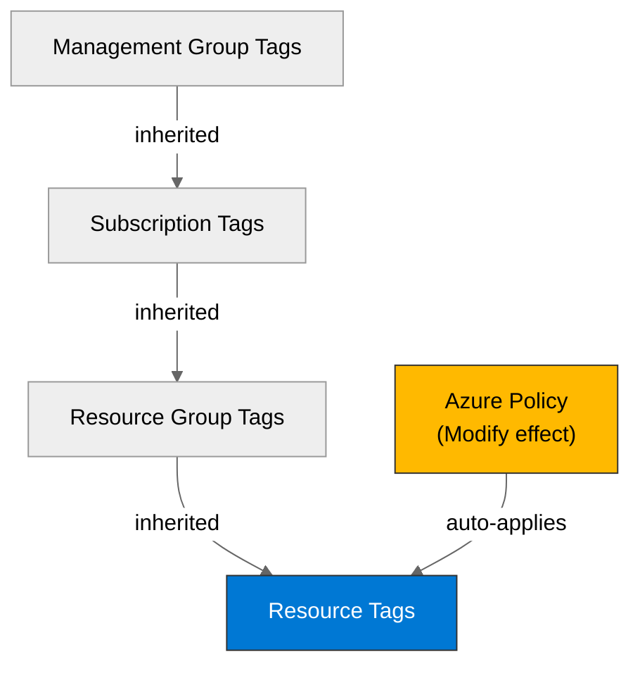

# 🛡️ Governance Constraints - nordic-foods

<strong>📑 Governance Contents</strong>

- [🔍 Discovery Source](#-discovery-source)
- [📋 Azure Policy Compliance](#-azure-policy-compliance)
- [🔄 Plan Adaptations Based on Policies](#-plan-adaptations-based-on-policies)
- [🚫 Deployment Blockers](#-deployment-blockers)
- [🏷️ Required Tags](#-required-tags)
- [🔐 Security Policies](#-security-policies)
- [💰 Cost Policies](#-cost-policies)
- [🌐 Network Policies](#-network-policies)
- [📜 Compliance Frameworks](#-compliance-frameworks)
- [References](#references)

> Generated by 04g-Governance agent | 2026-10-14T13:25:00Z

| ⬅️ Previous | 📑 Index | Next ➡️ |
| --- | --- | --- |
| [02-architecture-assessment.md](02-architecture-assessment.md) | [README](README.md) | [04-implementation-plan.md](04-implementation-plan.md) |

## 🔍 Discovery Source

| Query | Results | Timestamp |
| --- | --- | --- |
| Policy Assignments | 13 policies discovered | 2026-10-14T13:25:00Z |
| Tag Policies | 0 tags required | 2026-10-14T13:25:00Z |
| Security Policies | 2 constraints | 2026-10-14T13:25:00Z |

**Discovery Method**: Azure Policy REST API (discover.py)
**Subscription**: 7a2e8db9-42a4-4143-a9b5-c74fba49da74
**Scope**: Subscription + management-group inherited

> ⚠️ **4 Deny finding(s)** detected, all inherited from `ATOS-CZ-landing-zones`. None targets a resource type in the approved architecture (no AKS, no standalone network interfaces); see [Deployment Blockers](#-deployment-blockers). Discovery is `COMPLETE` (13 assignments, 0 exemptions); the Phase 2.7 confirmations are resolved below.

**Phase 2.7 confirmations (2026-10-14):** no policy-enforced tag keys, no location restriction (empty allow-list is not treated as proof of unrestricted deployment), and no RG/resource same-region policy. The `swedencentral` target and the greenfield APEX tag set are project choices, not policy mandates.

**Audit note:** the MFA Delete assignment `sys.mfa-delete` (built-in `f69cd8b8-9a6e-46b4-be84-244e8b127944`, tenant root group) uses effect `AuditAction`; it is audit-only and blocks nothing. The discovery script was patched to classify `AuditAction` as audit-class; earlier PARTIAL runs are superseded.

### Policy Definition Analysis

| Policy Display Name | Assignment Scope | Effect | Classification | Category | Bicep Property Path | Required Value |
| --- | --- | --- | --- | --- | --- | --- |
| Configure diagnostic settings for Storage Accounts to Log Analytics workspace | /providers/Microsoft.Management/managementGroups/ATOS-CZ | deployIfNotExists | auto-remediate | Storage |  | setbypolicy |
| Configure diagnostic settings for Blob Services to Log Analytics workspace | /providers/Microsoft.Management/managementGroups/ATOS-CZ | deployIfNotExists | auto-remediate | Storage |  | setbypolicy |
| Configure diagnostic settings for File Services to Log Analytics workspace | /providers/Microsoft.Management/managementGroups/ATOS-CZ | deployIfNotExists | auto-remediate | Storage |  | setbypolicy |
| Configure diagnostic settings for Queue Services to Log Analytics workspace | /providers/Microsoft.Management/managementGroups/ATOS-CZ | deployIfNotExists | auto-remediate | Storage |  | setbypolicy |
| Configure diagnostic settings for Table Services to Log Analytics workspace | /providers/Microsoft.Management/managementGroups/ATOS-CZ | deployIfNotExists | auto-remediate | Storage |  | setbypolicy |
| Deploy Diagnostic Settings for AVD Scaling Plans to Log Analytics workspace | /providers/Microsoft.Management/managementGroups/ATOS-CZ | deployIfNotExists | auto-remediate | Monitoring |  | True |
| Deploy Diagnostic Settings for AVD Application group to Log Analytics workspace | /providers/Microsoft.Management/managementGroups/ATOS-CZ | deployIfNotExists | auto-remediate | Monitoring |  | True |
| Deploy Diagnostic Settings for AVD Workspace to Log Analytics workspace | /providers/Microsoft.Management/managementGroups/ATOS-CZ | deployIfNotExists | auto-remediate | Monitoring |  | True |
| Deploy Diagnostic Settings for AVD Host Pools to Log Analytics workspace | /providers/Microsoft.Management/managementGroups/ATOS-CZ | deployIfNotExists | auto-remediate | Monitoring |  | True |
| Deploy Diagnostic Settings for Container Instances to Log Analytics workspace | /providers/Microsoft.Management/managementGroups/ATOS-CZ | deployIfNotExists | auto-remediate | Monitoring |  | True |
| Deploy Diagnostic Settings for Container Registry to Log Analytics workspace | /providers/Microsoft.Management/managementGroups/ATOS-CZ | deployIfNotExists | auto-remediate | Monitoring |  | True |
| Deploy - Configure diagnostic settings for Azure Kubernetes Service to Log Analytics workspace | /providers/Microsoft.Management/managementGroups/ATOS-CZ | deployIfNotExists | auto-remediate | Kubernetes |  | setbypolicy |
| Deploy Diagnostic Settings for Analysis Services to Log Analytics workspace | /providers/Microsoft.Management/managementGroups/ATOS-CZ | deployIfNotExists | auto-remediate | Monitoring |  | True |
| Deploy Diagnostic Settings for Azure API for FHIR to Log Analytics workspace | /providers/Microsoft.Management/managementGroups/ATOS-CZ | deployIfNotExists | auto-remediate | Monitoring |  | True |
| Deploy Diagnostic Settings for API Management to Log Analytics workspace | /providers/Microsoft.Management/managementGroups/ATOS-CZ | deployIfNotExists | auto-remediate | Monitoring |  | True |
| Deploy Diagnostic Settings for Application Gateway to Log Analytics workspace | /providers/Microsoft.Management/managementGroups/ATOS-CZ | deployIfNotExists | auto-remediate | Monitoring |  | True |
| Deploy Diagnostic Settings for Automation to Log Analytics workspace | /providers/Microsoft.Management/managementGroups/ATOS-CZ | deployIfNotExists | auto-remediate | Monitoring |  | True |
| Deploy Diagnostic Settings for Azure Bastion to Log Analytics workspace | /providers/Microsoft.Management/managementGroups/ATOS-CZ | deployIfNotExists | auto-remediate | Monitoring |  | True |
| Deploy Diagnostic Settings for Batch Account to Log Analytics workspace | /providers/Microsoft.Management/managementGroups/ATOS-CZ | deployIfNotExists | auto-remediate | Monitoring |  | setbypolicy |
| Deploy Diagnostic Settings for CDN Endpoint to Log Analytics workspace | /providers/Microsoft.Management/managementGroups/ATOS-CZ | deployIfNotExists | auto-remediate | Monitoring |  | True |
| Deploy Diagnostic Settings for Cognitive Services to Log Analytics workspace | /providers/Microsoft.Management/managementGroups/ATOS-CZ | deployIfNotExists | auto-remediate | Monitoring |  | True |
| Deploy Diagnostic Settings for Cosmos DB to Log Analytics workspace | /providers/Microsoft.Management/managementGroups/ATOS-CZ | deployIfNotExists | auto-remediate | Monitoring |  | True |
| Deploy Diagnostic Settings for Databricks to Log Analytics workspace | /providers/Microsoft.Management/managementGroups/ATOS-CZ | deployIfNotExists | auto-remediate | Monitoring |  | True |
| Deploy Diagnostic Settings for Azure Data Explorer Cluster to Log Analytics workspace | /providers/Microsoft.Management/managementGroups/ATOS-CZ | deployIfNotExists | auto-remediate | Monitoring |  | True |
| Deploy Diagnostic Settings for Data Factory to Log Analytics workspace | /providers/Microsoft.Management/managementGroups/ATOS-CZ | deployIfNotExists | auto-remediate | Monitoring |  | True |
| Deploy Diagnostic Settings for Data Lake Analytics to Log Analytics workspace | /providers/Microsoft.Management/managementGroups/ATOS-CZ | deployIfNotExists | auto-remediate | Monitoring |  | setbypolicy |
| Deploy Diagnostic Settings for Data Lake Analytics to Log Analytics workspace | /providers/Microsoft.Management/managementGroups/ATOS-CZ | deployIfNotExists | auto-remediate | Monitoring |  | True |
| Deploy Diagnostic Settings for Event Grid subscriptions to Log Analytics workspace | /providers/Microsoft.Management/managementGroups/ATOS-CZ | deployIfNotExists | auto-remediate | Monitoring |  | True |
| Deploy Diagnostic Settings for Event Grid Topic to Log Analytics workspace | /providers/Microsoft.Management/managementGroups/ATOS-CZ | deployIfNotExists | auto-remediate | Monitoring |  | True |
| Deploy Diagnostic Settings for Event Hub to Log Analytics workspace | /providers/Microsoft.Management/managementGroups/ATOS-CZ | deployIfNotExists | auto-remediate | Monitoring |  | setbypolicy |
| Deploy Diagnostic Settings for Event Grid System Topic to Log Analytics workspace | /providers/Microsoft.Management/managementGroups/ATOS-CZ | deployIfNotExists | auto-remediate | Monitoring |  | True |
| Deploy Diagnostic Settings for ExpressRoute to Log Analytics workspace | /providers/Microsoft.Management/managementGroups/ATOS-CZ | deployIfNotExists | auto-remediate | Monitoring |  | True |
| Deploy Diagnostic Settings for Firewall to Log Analytics workspace | /providers/Microsoft.Management/managementGroups/ATOS-CZ | deployIfNotExists | auto-remediate | Monitoring |  | True |
| Deploy Diagnostic Settings for Front Door to Log Analytics workspace | /providers/Microsoft.Management/managementGroups/ATOS-CZ | deployIfNotExists | auto-remediate | Monitoring |  | True |
| Deploy Diagnostic Settings for Azure Function App to Log Analytics workspace | /providers/Microsoft.Management/managementGroups/ATOS-CZ | deployIfNotExists | auto-remediate | Monitoring |  | True |
| Deploy Diagnostic Settings for HDInsight to Log Analytics workspace | /providers/Microsoft.Management/managementGroups/ATOS-CZ | deployIfNotExists | auto-remediate | Monitoring |  | True |
| Deploy Diagnostic Settings for IoT Hub to Log Analytics workspace | /providers/Microsoft.Management/managementGroups/ATOS-CZ | deployIfNotExists | auto-remediate | Monitoring |  | True |
| Deploy Diagnostic Settings for Key Vault to Log Analytics workspace | /providers/Microsoft.Management/managementGroups/ATOS-CZ | deployIfNotExists | auto-remediate | Monitoring |  | setbypolicy |
| Deploy Diagnostic Settings for Load Balancer to Log Analytics workspace | /providers/Microsoft.Management/managementGroups/ATOS-CZ | deployIfNotExists | auto-remediate | Monitoring |  | True |
| Deploy Diagnostic Settings for Log Analytics to Log Analytics workspace | /providers/Microsoft.Management/managementGroups/ATOS-CZ | deployIfNotExists | auto-remediate | Monitoring |  | True |
| Deploy Diagnostic Settings for Logic Apps integration service environment to Log Analytics workspace | /providers/Microsoft.Management/managementGroups/ATOS-CZ | deployIfNotExists | auto-remediate | Monitoring |  | True |
| Deploy Diagnostic Settings for Logic Apps to Log Analytics workspace | /providers/Microsoft.Management/managementGroups/ATOS-CZ | deployIfNotExists | auto-remediate | Monitoring |  | setbypolicy |
| Deploy Diagnostic Settings for MariaDB to Log Analytics workspace | /providers/Microsoft.Management/managementGroups/ATOS-CZ | deployIfNotExists | auto-remediate | Monitoring |  | True |
| Deploy Diagnostic Settings for Azure Media Service to Log Analytics workspace | /providers/Microsoft.Management/managementGroups/ATOS-CZ | deployIfNotExists | auto-remediate | Monitoring |  | True |
| Deploy Diagnostic Settings for Machine Learning workspace to Log Analytics workspace | /providers/Microsoft.Management/managementGroups/ATOS-CZ | deployIfNotExists | auto-remediate | Monitoring |  | True |
| Deploy Diagnostic Settings for Database for MySQL to Log Analytics workspace | /providers/Microsoft.Management/managementGroups/ATOS-CZ | deployIfNotExists | auto-remediate | Monitoring |  | True |
| Deploy Diagnostic Settings for Network Security Groups to Log Analytics workspace | /providers/Microsoft.Management/managementGroups/ATOS-CZ | deployIfNotExists | auto-remediate | Monitoring |  | True |
| Deploy Diagnostic Settings for Network Interfaces to Log Analytics workspace | /providers/Microsoft.Management/managementGroups/ATOS-CZ | deployIfNotExists | auto-remediate | Monitoring |  | True |
| Deploy Diagnostic Settings for Database for PostgreSQL to Log Analytics workspace | /providers/Microsoft.Management/managementGroups/ATOS-CZ | deployIfNotExists | auto-remediate | Monitoring |  | True |
| Deploy Diagnostic Settings for Power BI Embedded to Log Analytics workspace | /providers/Microsoft.Management/managementGroups/ATOS-CZ | deployIfNotExists | auto-remediate | Monitoring |  | True |
| Public IP addresses should have resource logs enabled for Azure DDoS Protection | /providers/Microsoft.Management/managementGroups/ATOS-CZ | deployIfNotExists | auto-remediate | Monitoring |  | True |
| Deploy Diagnostic Settings for Recovery Services Vault to Log Analytics workspace for resource specific categories. | /providers/Microsoft.Management/managementGroups/ATOS-CZ | deployIfNotExists | auto-remediate | Backup |  | setbypolicy |
| Deploy Diagnostic Settings for Redis Cache to Log Analytics workspace | /providers/Microsoft.Management/managementGroups/ATOS-CZ | deployIfNotExists | auto-remediate | Monitoring |  | True |
| Deploy Diagnostic Settings for Relay to Log Analytics workspace | /providers/Microsoft.Management/managementGroups/ATOS-CZ | deployIfNotExists | auto-remediate | Monitoring |  | True |
| Deploy Diagnostic Settings for Search Services to Log Analytics workspace | /providers/Microsoft.Management/managementGroups/ATOS-CZ | deployIfNotExists | auto-remediate | Monitoring |  | setbypolicy |
| Deploy Diagnostic Settings for Service Bus to Log Analytics workspace | /providers/Microsoft.Management/managementGroups/ATOS-CZ | deployIfNotExists | auto-remediate | Monitoring |  | setbypolicy |
| Deploy Diagnostic Settings for SignalR to Log Analytics workspace | /providers/Microsoft.Management/managementGroups/ATOS-CZ | deployIfNotExists | auto-remediate | Monitoring |  | True |
| Deploy - Configure diagnostic settings for SQL Databases to Log Analytics workspace | /providers/Microsoft.Management/managementGroups/ATOS-CZ | deployIfNotExists | auto-remediate | SQL |  | setbypolicy |
| Deploy Diagnostic Settings for SQL Elastic Pools to Log Analytics workspace | /providers/Microsoft.Management/managementGroups/ATOS-CZ | deployIfNotExists | auto-remediate | Monitoring |  | True |
| Deploy Diagnostic Settings for SQL Managed Instances to Log Analytics workspace | /providers/Microsoft.Management/managementGroups/ATOS-CZ | deployIfNotExists | auto-remediate | Monitoring |  | True |
| Deploy Diagnostic Settings for Stream Analytics to Log Analytics workspace | /providers/Microsoft.Management/managementGroups/ATOS-CZ | deployIfNotExists | auto-remediate | Monitoring |  | setbypolicy |
| Deploy Diagnostic Settings for Time Series Insights to Log Analytics workspace | /providers/Microsoft.Management/managementGroups/ATOS-CZ | deployIfNotExists | auto-remediate | Monitoring |  | True |
| Deploy Diagnostic Settings for Traffic Manager to Log Analytics workspace | /providers/Microsoft.Management/managementGroups/ATOS-CZ | deployIfNotExists | auto-remediate | Monitoring |  | True |
| Deploy Diagnostic Settings for Virtual Network to Log Analytics workspace | /providers/Microsoft.Management/managementGroups/ATOS-CZ | deployIfNotExists | auto-remediate | Monitoring |  | True |
| Deploy Diagnostic Settings for Virtual Machines to Log Analytics workspace | /providers/Microsoft.Management/managementGroups/ATOS-CZ | deployIfNotExists | auto-remediate | Monitoring |  | True |
| Deploy Diagnostic Settings for Virtual Machine Scale Sets to Log Analytics workspace | /providers/Microsoft.Management/managementGroups/ATOS-CZ | deployIfNotExists | auto-remediate | Monitoring |  | True |
| Deploy Diagnostic Settings for VPN Gateway to Log Analytics workspace | /providers/Microsoft.Management/managementGroups/ATOS-CZ | deployIfNotExists | auto-remediate | Monitoring |  | True |
| Deploy Diagnostic Settings for App Service Plan to Log Analytics workspace | /providers/Microsoft.Management/managementGroups/ATOS-CZ | deployIfNotExists | auto-remediate | Monitoring |  | True |
| Deploy Diagnostic Settings for App Service to Log Analytics workspace | /providers/Microsoft.Management/managementGroups/ATOS-CZ | deployIfNotExists | auto-remediate | Monitoring |  | True |
| Configure Azure Activity logs to stream to specified Log Analytics workspace | /providers/Microsoft.Management/managementGroups/ATOS-CZ | deployIfNotExists | auto-remediate | Monitoring |  | True |
| Deploy Azure Policy Add-on to Azure Kubernetes Service clusters | /providers/Microsoft.Management/managementGroups/ATOS-CZ-landing-zones | deployIfNotExists | auto-remediate | Kubernetes |  |  |
| Kubernetes cluster should not allow privileged containers | /providers/Microsoft.Management/managementGroups/ATOS-CZ-landing-zones | deny | blocker | Kubernetes |  | Original |
| Configure Azure Defender to be enabled on SQL servers | /providers/Microsoft.Management/managementGroups/ATOS-CZ-landing-zones | deployIfNotExists | auto-remediate | SQL |  |  |
| Kubernetes clusters should not allow container privilege escalation | /providers/Microsoft.Management/managementGroups/ATOS-CZ-landing-zones | deny | blocker | Kubernetes |  | Original |
| Kubernetes clusters should be accessible only over HTTPS | /providers/Microsoft.Management/managementGroups/ATOS-CZ-landing-zones | deny | blocker | Kubernetes |  | Original |
| Network interfaces should disable IP forwarding | /providers/Microsoft.Management/managementGroups/ATOS-CZ-landing-zones | deny | blocker | Network | networkInterfaces::enableIpForwarding |  |

## 📋 Azure Policy Compliance

| Category | Constraint | Implementation | Status |
| --- | --- | --- | --- |
| Backup | Deploy Diagnostic Settings for Recovery Services Vault to Log Analytics workspace for resource specific categories. | See JSON findings[] for structured value. | ✅ |
| Kubernetes | Deploy - Configure diagnostic settings for Azure Kubernetes Service to Log Analytics workspace | See JSON findings[] for structured value. | ✅ |
| Kubernetes | Deploy Azure Policy Add-on to Azure Kubernetes Service clusters | See JSON findings[] for structured value. | ✅ |
| Kubernetes | Kubernetes cluster should not allow privileged containers | See JSON findings[] for structured value. | ❌ |
| Kubernetes | Kubernetes clusters should not allow container privilege escalation | See JSON findings[] for structured value. | ❌ |
| Kubernetes | Kubernetes clusters should be accessible only over HTTPS | See JSON findings[] for structured value. | ❌ |
| Monitoring | Deploy Diagnostic Settings for AVD Scaling Plans to Log Analytics workspace | See JSON findings[] for structured value. | ✅ |
| Monitoring | Deploy Diagnostic Settings for AVD Application group to Log Analytics workspace | See JSON findings[] for structured value. | ✅ |
| Monitoring | Deploy Diagnostic Settings for AVD Workspace to Log Analytics workspace | See JSON findings[] for structured value. | ✅ |
| Monitoring | Deploy Diagnostic Settings for AVD Host Pools to Log Analytics workspace | See JSON findings[] for structured value. | ✅ |
| Monitoring | Deploy Diagnostic Settings for Container Instances to Log Analytics workspace | See JSON findings[] for structured value. | ✅ |
| Monitoring | Deploy Diagnostic Settings for Container Registry to Log Analytics workspace | See JSON findings[] for structured value. | ✅ |
| Monitoring | Deploy Diagnostic Settings for Analysis Services to Log Analytics workspace | See JSON findings[] for structured value. | ✅ |
| Monitoring | Deploy Diagnostic Settings for Azure API for FHIR to Log Analytics workspace | See JSON findings[] for structured value. | ✅ |
| Monitoring | Deploy Diagnostic Settings for API Management to Log Analytics workspace | See JSON findings[] for structured value. | ✅ |
| Monitoring | Deploy Diagnostic Settings for Application Gateway to Log Analytics workspace | See JSON findings[] for structured value. | ✅ |
| Monitoring | Deploy Diagnostic Settings for Automation to Log Analytics workspace | See JSON findings[] for structured value. | ✅ |
| Monitoring | Deploy Diagnostic Settings for Azure Bastion to Log Analytics workspace | See JSON findings[] for structured value. | ✅ |
| Monitoring | Deploy Diagnostic Settings for Batch Account to Log Analytics workspace | See JSON findings[] for structured value. | ✅ |
| Monitoring | Deploy Diagnostic Settings for CDN Endpoint to Log Analytics workspace | See JSON findings[] for structured value. | ✅ |
| Monitoring | Deploy Diagnostic Settings for Cognitive Services to Log Analytics workspace | See JSON findings[] for structured value. | ✅ |
| Monitoring | Deploy Diagnostic Settings for Cosmos DB to Log Analytics workspace | See JSON findings[] for structured value. | ✅ |
| Monitoring | Deploy Diagnostic Settings for Databricks to Log Analytics workspace | See JSON findings[] for structured value. | ✅ |
| Monitoring | Deploy Diagnostic Settings for Azure Data Explorer Cluster to Log Analytics workspace | See JSON findings[] for structured value. | ✅ |
| Monitoring | Deploy Diagnostic Settings for Data Factory to Log Analytics workspace | See JSON findings[] for structured value. | ✅ |
| Monitoring | Deploy Diagnostic Settings for Data Lake Analytics to Log Analytics workspace | See JSON findings[] for structured value. | ✅ |
| Monitoring | Deploy Diagnostic Settings for Data Lake Analytics to Log Analytics workspace | See JSON findings[] for structured value. | ✅ |
| Monitoring | Deploy Diagnostic Settings for Event Grid subscriptions to Log Analytics workspace | See JSON findings[] for structured value. | ✅ |
| Monitoring | Deploy Diagnostic Settings for Event Grid Topic to Log Analytics workspace | See JSON findings[] for structured value. | ✅ |
| Monitoring | Deploy Diagnostic Settings for Event Hub to Log Analytics workspace | See JSON findings[] for structured value. | ✅ |
| Monitoring | Deploy Diagnostic Settings for Event Grid System Topic to Log Analytics workspace | See JSON findings[] for structured value. | ✅ |
| Monitoring | Deploy Diagnostic Settings for ExpressRoute to Log Analytics workspace | See JSON findings[] for structured value. | ✅ |
| Monitoring | Deploy Diagnostic Settings for Firewall to Log Analytics workspace | See JSON findings[] for structured value. | ✅ |
| Monitoring | Deploy Diagnostic Settings for Front Door to Log Analytics workspace | See JSON findings[] for structured value. | ✅ |
| Monitoring | Deploy Diagnostic Settings for Azure Function App to Log Analytics workspace | See JSON findings[] for structured value. | ✅ |
| Monitoring | Deploy Diagnostic Settings for HDInsight to Log Analytics workspace | See JSON findings[] for structured value. | ✅ |
| Monitoring | Deploy Diagnostic Settings for IoT Hub to Log Analytics workspace | See JSON findings[] for structured value. | ✅ |
| Monitoring | Deploy Diagnostic Settings for Key Vault to Log Analytics workspace | See JSON findings[] for structured value. | ✅ |
| Monitoring | Deploy Diagnostic Settings for Load Balancer to Log Analytics workspace | See JSON findings[] for structured value. | ✅ |
| Monitoring | Deploy Diagnostic Settings for Log Analytics to Log Analytics workspace | See JSON findings[] for structured value. | ✅ |
| Monitoring | Deploy Diagnostic Settings for Logic Apps integration service environment to Log Analytics workspace | See JSON findings[] for structured value. | ✅ |
| Monitoring | Deploy Diagnostic Settings for Logic Apps to Log Analytics workspace | See JSON findings[] for structured value. | ✅ |
| Monitoring | Deploy Diagnostic Settings for MariaDB to Log Analytics workspace | See JSON findings[] for structured value. | ✅ |
| Monitoring | Deploy Diagnostic Settings for Azure Media Service to Log Analytics workspace | See JSON findings[] for structured value. | ✅ |
| Monitoring | Deploy Diagnostic Settings for Machine Learning workspace to Log Analytics workspace | See JSON findings[] for structured value. | ✅ |
| Monitoring | Deploy Diagnostic Settings for Database for MySQL to Log Analytics workspace | See JSON findings[] for structured value. | ✅ |
| Monitoring | Deploy Diagnostic Settings for Network Security Groups to Log Analytics workspace | See JSON findings[] for structured value. | ✅ |
| Monitoring | Deploy Diagnostic Settings for Network Interfaces to Log Analytics workspace | See JSON findings[] for structured value. | ✅ |
| Monitoring | Deploy Diagnostic Settings for Database for PostgreSQL to Log Analytics workspace | See JSON findings[] for structured value. | ✅ |
| Monitoring | Deploy Diagnostic Settings for Power BI Embedded to Log Analytics workspace | See JSON findings[] for structured value. | ✅ |
| Monitoring | Public IP addresses should have resource logs enabled for Azure DDoS Protection | See JSON findings[] for structured value. | ✅ |
| Monitoring | Deploy Diagnostic Settings for Redis Cache to Log Analytics workspace | See JSON findings[] for structured value. | ✅ |
| Monitoring | Deploy Diagnostic Settings for Relay to Log Analytics workspace | See JSON findings[] for structured value. | ✅ |
| Monitoring | Deploy Diagnostic Settings for Search Services to Log Analytics workspace | See JSON findings[] for structured value. | ✅ |
| Monitoring | Deploy Diagnostic Settings for Service Bus to Log Analytics workspace | See JSON findings[] for structured value. | ✅ |
| Monitoring | Deploy Diagnostic Settings for SignalR to Log Analytics workspace | See JSON findings[] for structured value. | ✅ |
| Monitoring | Deploy Diagnostic Settings for SQL Elastic Pools to Log Analytics workspace | See JSON findings[] for structured value. | ✅ |
| Monitoring | Deploy Diagnostic Settings for SQL Managed Instances to Log Analytics workspace | See JSON findings[] for structured value. | ✅ |
| Monitoring | Deploy Diagnostic Settings for Stream Analytics to Log Analytics workspace | See JSON findings[] for structured value. | ✅ |
| Monitoring | Deploy Diagnostic Settings for Time Series Insights to Log Analytics workspace | See JSON findings[] for structured value. | ✅ |
| Monitoring | Deploy Diagnostic Settings for Traffic Manager to Log Analytics workspace | See JSON findings[] for structured value. | ✅ |
| Monitoring | Deploy Diagnostic Settings for Virtual Network to Log Analytics workspace | See JSON findings[] for structured value. | ✅ |
| Monitoring | Deploy Diagnostic Settings for Virtual Machines to Log Analytics workspace | See JSON findings[] for structured value. | ✅ |
| Monitoring | Deploy Diagnostic Settings for Virtual Machine Scale Sets to Log Analytics workspace | See JSON findings[] for structured value. | ✅ |
| Monitoring | Deploy Diagnostic Settings for VPN Gateway to Log Analytics workspace | See JSON findings[] for structured value. | ✅ |
| Monitoring | Deploy Diagnostic Settings for App Service Plan to Log Analytics workspace | See JSON findings[] for structured value. | ✅ |
| Monitoring | Deploy Diagnostic Settings for App Service to Log Analytics workspace | See JSON findings[] for structured value. | ✅ |
| Monitoring | Configure Azure Activity logs to stream to specified Log Analytics workspace | See JSON findings[] for structured value. | ✅ |
| Network | Network interfaces should disable IP forwarding | See JSON findings[] for structured value. | ❌ |
| SQL | Deploy - Configure diagnostic settings for SQL Databases to Log Analytics workspace | See JSON findings[] for structured value. | ✅ |
| SQL | Configure Azure Defender to be enabled on SQL servers | See JSON findings[] for structured value. | ✅ |
| Storage | Configure diagnostic settings for Storage Accounts to Log Analytics workspace | See JSON findings[] for structured value. | ✅ |
| Storage | Configure diagnostic settings for Blob Services to Log Analytics workspace | See JSON findings[] for structured value. | ✅ |
| Storage | Configure diagnostic settings for File Services to Log Analytics workspace | See JSON findings[] for structured value. | ✅ |
| Storage | Configure diagnostic settings for Queue Services to Log Analytics workspace | See JSON findings[] for structured value. | ✅ |
| Storage | Configure diagnostic settings for Table Services to Log Analytics workspace | See JSON findings[] for structured value. | ✅ |

## 🔄 Plan Adaptations Based on Policies

### Architectural Changes

| Original Design | Blocking Policy | Effect | Target Resource Types | Adaptation Applied |
| --- | --- | --- | --- | --- |
| No AKS in the approved architecture (App Service containers). | Kubernetes cluster should not allow privileged containers | deny |  | Not applicable; re-check if AKS is introduced. |
| No AKS in the approved architecture (App Service containers). | Kubernetes clusters should not allow container privilege escalation | deny |  | Not applicable; re-check if AKS is introduced. |
| No AKS in the approved architecture (App Service containers). | Kubernetes clusters should be accessible only over HTTPS | deny |  | Not applicable; re-check if AKS is introduced. |
| The architecture has no VM or standalone NIC; private endpoints create managed NICs. | Network interfaces should disable IP forwarding | deny | Microsoft.Network/networkInterfaces | Planner keeps `enableIpForwarding` false (or unset) on any NIC it declares; private endpoint NICs are platform-managed. |

### Auto-Applied Resources

| Policy | Effect | Auto-Applied Resource |
| --- | --- | --- |
| Configure diagnostic settings for Storage Accounts to Log Analytics workspace | DeployIfNotExists | Auto-deployed by Azure Policy |
| Configure diagnostic settings for Blob Services to Log Analytics workspace | DeployIfNotExists | Auto-deployed by Azure Policy |
| Configure diagnostic settings for File Services to Log Analytics workspace | DeployIfNotExists | Auto-deployed by Azure Policy |
| Configure diagnostic settings for Queue Services to Log Analytics workspace | DeployIfNotExists | Auto-deployed by Azure Policy |
| Configure diagnostic settings for Table Services to Log Analytics workspace | DeployIfNotExists | Auto-deployed by Azure Policy |
| Deploy Diagnostic Settings for AVD Scaling Plans to Log Analytics workspace | DeployIfNotExists | Auto-deployed by Azure Policy |
| Deploy Diagnostic Settings for AVD Application group to Log Analytics workspace | DeployIfNotExists | Auto-deployed by Azure Policy |
| Deploy Diagnostic Settings for AVD Workspace to Log Analytics workspace | DeployIfNotExists | Auto-deployed by Azure Policy |
| Deploy Diagnostic Settings for AVD Host Pools to Log Analytics workspace | DeployIfNotExists | Auto-deployed by Azure Policy |
| Deploy Diagnostic Settings for Container Instances to Log Analytics workspace | DeployIfNotExists | Auto-deployed by Azure Policy |
| Deploy Diagnostic Settings for Container Registry to Log Analytics workspace | DeployIfNotExists | Auto-deployed by Azure Policy |
| Deploy - Configure diagnostic settings for Azure Kubernetes Service to Log Analytics workspace | DeployIfNotExists | Auto-deployed by Azure Policy |
| Deploy Diagnostic Settings for Analysis Services to Log Analytics workspace | DeployIfNotExists | Auto-deployed by Azure Policy |
| Deploy Diagnostic Settings for Azure API for FHIR to Log Analytics workspace | DeployIfNotExists | Auto-deployed by Azure Policy |
| Deploy Diagnostic Settings for API Management to Log Analytics workspace | DeployIfNotExists | Auto-deployed by Azure Policy |
| Deploy Diagnostic Settings for Application Gateway to Log Analytics workspace | DeployIfNotExists | Auto-deployed by Azure Policy |
| Deploy Diagnostic Settings for Automation to Log Analytics workspace | DeployIfNotExists | Auto-deployed by Azure Policy |
| Deploy Diagnostic Settings for Azure Bastion to Log Analytics workspace | DeployIfNotExists | Auto-deployed by Azure Policy |
| Deploy Diagnostic Settings for Batch Account to Log Analytics workspace | DeployIfNotExists | Auto-deployed by Azure Policy |
| Deploy Diagnostic Settings for CDN Endpoint to Log Analytics workspace | DeployIfNotExists | Auto-deployed by Azure Policy |
| Deploy Diagnostic Settings for Cognitive Services to Log Analytics workspace | DeployIfNotExists | Auto-deployed by Azure Policy |
| Deploy Diagnostic Settings for Cosmos DB to Log Analytics workspace | DeployIfNotExists | Auto-deployed by Azure Policy |
| Deploy Diagnostic Settings for Databricks to Log Analytics workspace | DeployIfNotExists | Auto-deployed by Azure Policy |
| Deploy Diagnostic Settings for Azure Data Explorer Cluster to Log Analytics workspace | DeployIfNotExists | Auto-deployed by Azure Policy |
| Deploy Diagnostic Settings for Data Factory to Log Analytics workspace | DeployIfNotExists | Auto-deployed by Azure Policy |
| Deploy Diagnostic Settings for Data Lake Analytics to Log Analytics workspace | DeployIfNotExists | Auto-deployed by Azure Policy |
| Deploy Diagnostic Settings for Data Lake Analytics to Log Analytics workspace | DeployIfNotExists | Auto-deployed by Azure Policy |
| Deploy Diagnostic Settings for Event Grid subscriptions to Log Analytics workspace | DeployIfNotExists | Auto-deployed by Azure Policy |
| Deploy Diagnostic Settings for Event Grid Topic to Log Analytics workspace | DeployIfNotExists | Auto-deployed by Azure Policy |
| Deploy Diagnostic Settings for Event Hub to Log Analytics workspace | DeployIfNotExists | Auto-deployed by Azure Policy |
| Deploy Diagnostic Settings for Event Grid System Topic to Log Analytics workspace | DeployIfNotExists | Auto-deployed by Azure Policy |
| Deploy Diagnostic Settings for ExpressRoute to Log Analytics workspace | DeployIfNotExists | Auto-deployed by Azure Policy |
| Deploy Diagnostic Settings for Firewall to Log Analytics workspace | DeployIfNotExists | Auto-deployed by Azure Policy |
| Deploy Diagnostic Settings for Front Door to Log Analytics workspace | DeployIfNotExists | Auto-deployed by Azure Policy |
| Deploy Diagnostic Settings for Azure Function App to Log Analytics workspace | DeployIfNotExists | Auto-deployed by Azure Policy |
| Deploy Diagnostic Settings for HDInsight to Log Analytics workspace | DeployIfNotExists | Auto-deployed by Azure Policy |
| Deploy Diagnostic Settings for IoT Hub to Log Analytics workspace | DeployIfNotExists | Auto-deployed by Azure Policy |
| Deploy Diagnostic Settings for Key Vault to Log Analytics workspace | DeployIfNotExists | Auto-deployed by Azure Policy |
| Deploy Diagnostic Settings for Load Balancer to Log Analytics workspace | DeployIfNotExists | Auto-deployed by Azure Policy |
| Deploy Diagnostic Settings for Log Analytics to Log Analytics workspace | DeployIfNotExists | Auto-deployed by Azure Policy |
| Deploy Diagnostic Settings for Logic Apps integration service environment to Log Analytics workspace | DeployIfNotExists | Auto-deployed by Azure Policy |
| Deploy Diagnostic Settings for Logic Apps to Log Analytics workspace | DeployIfNotExists | Auto-deployed by Azure Policy |
| Deploy Diagnostic Settings for MariaDB to Log Analytics workspace | DeployIfNotExists | Auto-deployed by Azure Policy |
| Deploy Diagnostic Settings for Azure Media Service to Log Analytics workspace | DeployIfNotExists | Auto-deployed by Azure Policy |
| Deploy Diagnostic Settings for Machine Learning workspace to Log Analytics workspace | DeployIfNotExists | Auto-deployed by Azure Policy |
| Deploy Diagnostic Settings for Database for MySQL to Log Analytics workspace | DeployIfNotExists | Auto-deployed by Azure Policy |
| Deploy Diagnostic Settings for Network Security Groups to Log Analytics workspace | DeployIfNotExists | Auto-deployed by Azure Policy |
| Deploy Diagnostic Settings for Network Interfaces to Log Analytics workspace | DeployIfNotExists | Auto-deployed by Azure Policy |
| Deploy Diagnostic Settings for Database for PostgreSQL to Log Analytics workspace | DeployIfNotExists | Auto-deployed by Azure Policy |
| Deploy Diagnostic Settings for Power BI Embedded to Log Analytics workspace | DeployIfNotExists | Auto-deployed by Azure Policy |
| Public IP addresses should have resource logs enabled for Azure DDoS Protection | DeployIfNotExists | Auto-deployed by Azure Policy |
| Deploy Diagnostic Settings for Recovery Services Vault to Log Analytics workspace for resource specific categories. | DeployIfNotExists | Auto-deployed by Azure Policy |
| Deploy Diagnostic Settings for Redis Cache to Log Analytics workspace | DeployIfNotExists | Auto-deployed by Azure Policy |
| Deploy Diagnostic Settings for Relay to Log Analytics workspace | DeployIfNotExists | Auto-deployed by Azure Policy |
| Deploy Diagnostic Settings for Search Services to Log Analytics workspace | DeployIfNotExists | Auto-deployed by Azure Policy |
| Deploy Diagnostic Settings for Service Bus to Log Analytics workspace | DeployIfNotExists | Auto-deployed by Azure Policy |
| Deploy Diagnostic Settings for SignalR to Log Analytics workspace | DeployIfNotExists | Auto-deployed by Azure Policy |
| Deploy - Configure diagnostic settings for SQL Databases to Log Analytics workspace | DeployIfNotExists | Auto-deployed by Azure Policy |
| Deploy Diagnostic Settings for SQL Elastic Pools to Log Analytics workspace | DeployIfNotExists | Auto-deployed by Azure Policy |
| Deploy Diagnostic Settings for SQL Managed Instances to Log Analytics workspace | DeployIfNotExists | Auto-deployed by Azure Policy |
| Deploy Diagnostic Settings for Stream Analytics to Log Analytics workspace | DeployIfNotExists | Auto-deployed by Azure Policy |
| Deploy Diagnostic Settings for Time Series Insights to Log Analytics workspace | DeployIfNotExists | Auto-deployed by Azure Policy |
| Deploy Diagnostic Settings for Traffic Manager to Log Analytics workspace | DeployIfNotExists | Auto-deployed by Azure Policy |
| Deploy Diagnostic Settings for Virtual Network to Log Analytics workspace | DeployIfNotExists | Auto-deployed by Azure Policy |
| Deploy Diagnostic Settings for Virtual Machines to Log Analytics workspace | DeployIfNotExists | Auto-deployed by Azure Policy |
| Deploy Diagnostic Settings for Virtual Machine Scale Sets to Log Analytics workspace | DeployIfNotExists | Auto-deployed by Azure Policy |
| Deploy Diagnostic Settings for VPN Gateway to Log Analytics workspace | DeployIfNotExists | Auto-deployed by Azure Policy |
| Deploy Diagnostic Settings for App Service Plan to Log Analytics workspace | DeployIfNotExists | Auto-deployed by Azure Policy |
| Deploy Diagnostic Settings for App Service to Log Analytics workspace | DeployIfNotExists | Auto-deployed by Azure Policy |
| Configure Azure Activity logs to stream to specified Log Analytics workspace | DeployIfNotExists | Auto-deployed by Azure Policy |
| Deploy Azure Policy Add-on to Azure Kubernetes Service clusters | DeployIfNotExists | Auto-deployed by Azure Policy |
| Configure Azure Defender to be enabled on SQL servers | DeployIfNotExists | Auto-deployed by Azure Policy |

**DINE ownership note:** the diagnostic-settings policies (`Deploy-Resource-Diag`, `Deploy-AzActivity-Log`) target the central workspace `ATOS-CZ-la` (resource group `ATOS-CZ-mgmt`), which is outside the project.

**DINE destination is unverified (Step 4 gate):** the live assignment parameter `logAnalytics` carries the literal all-zero subscription GUID (`/subscriptions/00000000-0000-0000-0000-000000000000/resourceGroups/ATOS-CZ-mgmt/providers/Microsoft.OperationalInsights/workspaces/ATOS-CZ-la`, verified against the live assignment on 2026-10-14), and that ID does not resolve (`Subscription '00000000-...' not found`). The discovery JSON records no destination region or retention parameter. DINE diagnostics therefore must not be treated as effective or as a compliant log copy until Step 4 verifies:

1. the real workspace resource ID, region (EU residency) and retention against the 30-day cap in ADR-0003 and the Step 1 GDPR decision;
2. the assignment's identity permissions, remediation behavior and whether remediation succeeds with the recorded ID;
3. duplicate-setting ownership between policy and Terraform for App Service, App Service Plan, SQL Database, Key Vault, Container Registry, Storage and Network resources (declare project diagnostics in IaC only where ownership is verified, and to avoid duplicate settings).

Existing non-compliance may need an explicitly authorized remediation task. Policy diagnostics do not replace project-level monitoring or the 30-day log retention cap.

### Auto-Modified Configurations

✅ No auto-modifications expected.

## 🚫 Deployment Blockers

> **4** blocker finding(s) from **4** unique policies (duplicates from multi-scope inheritance are consolidated below).

### Kubernetes cluster should not allow privileged containers

- **Policy ID**: `/providers/Microsoft.Authorization/policyDefinitions/95edb821-ddaf-4404-9732-666045e056b4`
- **Effect**: deny
- **Scope**: /providers/Microsoft.Management/managementGroups/ATOS-CZ-landing-zones
- **Category**: Kubernetes
- **Bicep Property Path**: ``
- **Required Value**: Original

> **Applicability**: Not applicable. The architecture has no Kubernetes cluster. Re-check if AKS is introduced.

### Kubernetes clusters should not allow container privilege escalation

- **Policy ID**: `/providers/Microsoft.Authorization/policyDefinitions/1c6e92c9-99f0-4e55-9cf2-0c234dc48f99`
- **Effect**: deny
- **Scope**: /providers/Microsoft.Management/managementGroups/ATOS-CZ-landing-zones
- **Category**: Kubernetes
- **Bicep Property Path**: ``
- **Required Value**: Original

> **Applicability**: Not applicable. The architecture has no Kubernetes cluster. Re-check if AKS is introduced.

### Kubernetes clusters should be accessible only over HTTPS

- **Policy ID**: `/providers/Microsoft.Authorization/policyDefinitions/1a5b4dca-0b6f-4cf5-907c-56316bc1bf3d`
- **Effect**: deny
- **Scope**: /providers/Microsoft.Management/managementGroups/ATOS-CZ-landing-zones
- **Category**: Kubernetes
- **Bicep Property Path**: ``
- **Required Value**: Original

> **Applicability**: Not applicable. The architecture has no Kubernetes cluster. Re-check if AKS is introduced.

### Network interfaces should disable IP forwarding

- **Policy ID**: `/providers/Microsoft.Authorization/policyDefinitions/88c0b9da-ce96-4b03-9635-f29a937e2900`
- **Effect**: deny
- **Scope**: /providers/Microsoft.Management/managementGroups/ATOS-CZ-landing-zones
- **Category**: Network
- **Bicep Property Path**: `networkInterfaces::enableIpForwarding`
- **Required Value**: `enableIpForwarding` must be false (policy name; no parameters supplied by the assignment)

> **Applicability**: Low risk. The architecture declares no VM or standalone NIC. Step 4 keeps IP forwarding disabled on any NIC it declares; private endpoint NICs are platform-managed.

## 🏷️ Required Tags

No tag-enforcement policies discovered among the 13 effective assignments, so no policy-mandated keys exist. Phase 2.7 confirmation (2026-10-14): none enforced by policy. The greenfield APEX tag set (lowercase) remains a project choice, and tag policy must be re-checked at deploy time because a tag-deny policy can appear later at any inherited scope.

## 🔐 Security Policies

| Policy | Effect | Status |
| --- | --- | --- |
| Deploy Diagnostic Settings for Key Vault to Log Analytics workspace | deployIfNotExists | ✅ |
| Kubernetes clusters should be accessible only over HTTPS | deny | ❌ |

## 💰 Cost Policies

No cost-specific policies discovered.

## 🌐 Network Policies

No private DNS, private endpoint, public network access, or allowed-location policy was discovered. The private-networking baseline therefore comes from the security baseline and the approved architecture, not from policy. Confirmed: no location restriction and no RG/resource same-region requirement (project choice to align in `swedencentral`).

| Policy | Effect | Constraint |
| --- | --- | --- |
| Network interfaces should disable IP forwarding | deny | `enableIpForwarding` must be false; no NIC declared by the architecture |
| Deploy Diagnostic Settings for Firewall to Log Analytics workspace | deployIfNotExists | True |
| Deploy Diagnostic Settings for Virtual Network to Log Analytics workspace | deployIfNotExists | True |

## 📜 Compliance Frameworks

> These audit/compliance assignments are active at subscription or management-group scope. 
> While they do not block deployments (audit effect), they may impose architecture constraints 
> (data residency, encryption, access logging, network segmentation).

| Assignment | Scope | Type |
| --- | --- | --- |
| Microsoft Azure Multi Factor Authentication Enforcement for Resource Delete Actions (`sys.mfa-delete`) | /providers/Microsoft.Management/managementGroups/eba79b85-30bf-48fc-867d-fd41755dc69c | management-group |
| Microsoft Azure Multi Factor Authentication Enforcement for Resource Write Actions (`sys.mfa-write`) | /providers/Microsoft.Management/managementGroups/eba79b85-30bf-48fc-867d-fd41755dc69c | management-group |
| Auditing on SQL server should be enabled (`Deploy-SQL-DB-Auditing`) | /providers/Microsoft.Management/managementGroups/ATOS-CZ-landing-zones | management-group |

**Audit-class effects (all three; `audit_count` = 3).** The discovery JSON retains only the count and the assignment inventory, not per-policy audit records, so the effects below come from the live assignments and built-in definitions read on 2026-10-14:

| Assignment | Definition ID | Effective effect | Source |
| --- | --- | --- | --- |
| `sys.mfa-delete` | `f69cd8b8-9a6e-46b4-be84-244e8b127944` | `AuditAction` (assignment parameter) | live assignment, built-in definition (default `AuditAction`) |
| `sys.mfa-write` | `54f51f64-eaa5-44cf-8674-830bcfd14d21` | `Audit` (assignment parameter) | live assignment, built-in definition (default `Audit`) |
| `Deploy-SQL-DB-Auditing` | `a6fb4358-5bf4-4ad7-ba82-2cd2f41ce5e9` | `AuditIfNotExists` (definition default; assignment supplies no parameters) | built-in definition |

All three are audit-only and block nothing. Expected action for Step 4: enable Azure SQL auditing on the project SQL server as a best-effort compliant setting (the policy reports non-compliance when auditing is absent), and plan the destination and retention within the 30-day cap and EU residency. The MFA policies need no IaC action; they audit interactive operations and may affect operator procedure only.

## References

| Topic | Link |
| --- | --- |
| Azure Policy | [Overview](https://learn.microsoft.com/azure/governance/policy/overview) |
| Tag Governance | [Tagging Strategy](https://learn.microsoft.com/azure/cloud-adoption-framework/ready/azure-best-practices/resource-tagging) |

---

_Governance constraints discovered from Azure Policy REST API via discover.py._

